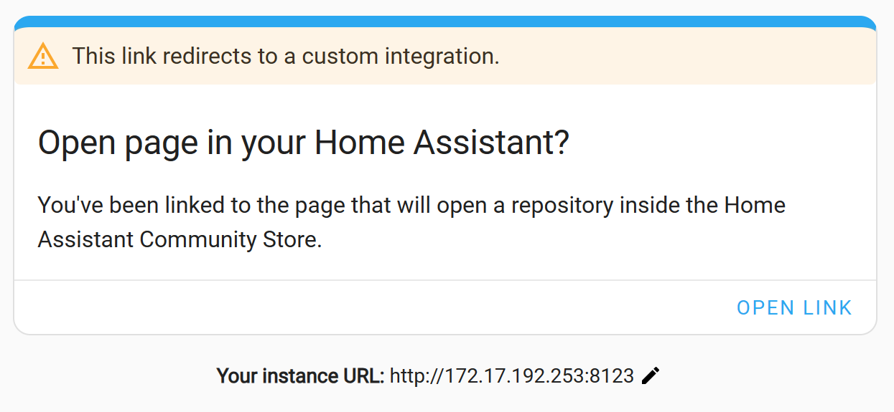
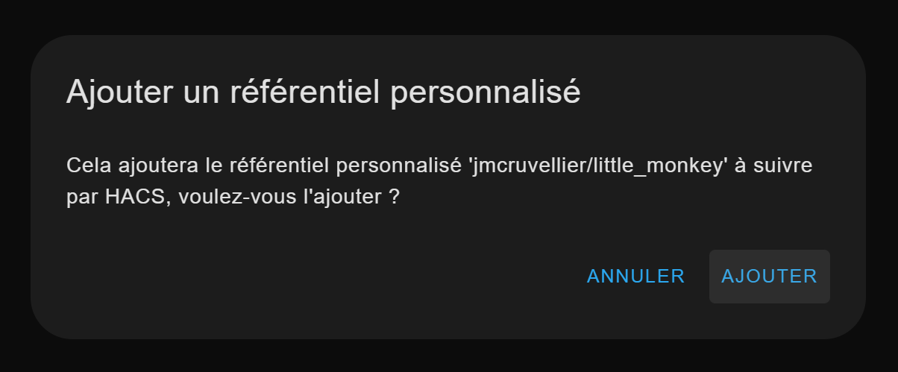
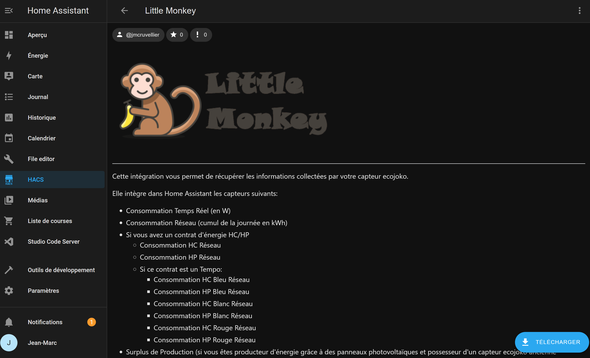

# Installation & Configuration

## Installation pas à pas

1. Cliquer sur le lien d'installation, saisir l'adresse de votre instance Home Assistant, puis cliquer sur "Open Link":



2. Cliquer sur le bouton "Ajouter":



3. Cliquer sur le bouton "Télécharger" en bas de la page:



4. Cliquer sur le bouton "Télécharger":


5. L'intégration "Little Monkey" apparaît dans le Home Assistant Community Store (HACS):


6. Il est nécessaire de redémarrer Home Assistant pour que l'intégration fonctionne:
  - Aller dans "Paramètres":

  

  - Cliquer sur le message "Restart required" puis sur le bouton "Valider":

  

7. Le redémarrage est lancé:
  


## Configuration

Une fois Home Assistant redémarré, l'intégration peut maintenant être configurée.

1.  Aller dans "Paramètres", "Appareils et Services" et dans l'onglet "Intégrations" cliquer sur le bouton "Ajouter une Intégration". Rechercher "Little Monkey" et cliquer dessus:


2. Saisir et Sélectionner les options de configurations:
  - Nom: nom qui sera utilisé pour préfixer les noms de tous les capteurs
  - Nom d'utilisateur et Mot de passe: vos identifiants ecojoko<sup>©️</sup>
  - Capteurs HP/HC: à ne sélectionner que si vous avez renseigné un tarif d'électricité avec des Heures Creuses dans ecojoko<sup>©️</sup>
  - Capteurs Tempo Bleu/Blanc/Rouge: à ne sélectionner que si vous avez renseigné un tarif d'électricité Tempo
  - Capteurs d'humidité et de température: à ne sélectionner que si vous désirez remonter ces données depuis votre ecojoko<sup>©️</sup>
  - Capteur de production: à ne sélectionner que si vous êtes producteur d'énergie solaire et que vous avez un capteur ecojoko<sup>©️</sup> ancienne génération
  - Fréquence de rafraîchissement des données (en secondes): le minimum autorisé est de 3 secondes (afin de ne pas surcharger les serveurs d'ecojoko<sup>©️</sup>), et le maximum est de 60 secondes

> [!IMPORTANT]
> Un changement de nom après la première configuration renomme l'appareil et le nom affiché des capteurs. Depuis la version 1.2.8, les capteurs eux-mêmes sont conservés, avec leurs identifiants et leur historique

> [!NOTE]
> Les noms des capteurs suivent la langue de votre instance Home Assistant (français, anglais ou portugais ; anglais pour les autres langues). Depuis la version 1.2.8 il n'y a plus de choix de langue dans ce formulaire, contrairement à ce que montre la capture d'écran ci-dessous.


3. La configuration est terminée:


4. Voici un exemple de tous les capteurs créés:


## Carte du tableau de bord

Depuis la version 1.3.0, l'intégration fournit la carte « Little Monkey ». Elle est chargée automatiquement par Home Assistant : il n'y a pas de ressource Lovelace à ajouter, ni de dépôt HACS supplémentaire à installer. Elle nécessite Home Assistant 2024.7 ou plus récent.

Pour l'ajouter, modifier un tableau de bord, cliquer sur "Ajouter une carte" et chercher "Little Monkey" (ou "Petit Singe"), ou utiliser la configuration YAML suivante, en remplaçant l'entité par votre capteur Consommation Temps Réel:

```yaml
type: custom:little-monkey-card
entity: sensor.ecojoko_consommation_temps_reel
```

> [!TIP]
> Après une mise à jour de l'intégration, si la carte n'apparaît pas ou n'a pas changé, actualisez la page en vidant le cache du navigateur (Ctrl+F5), et sur l'application mobile videz le cache du frontend depuis les paramètres de l'application.
