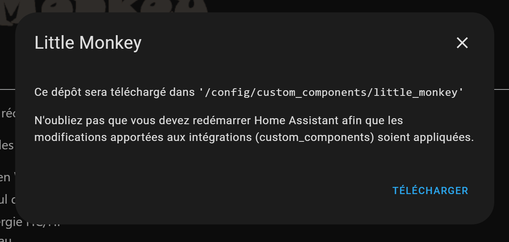
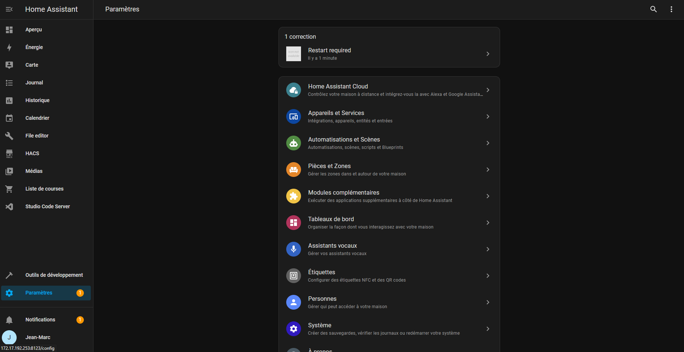
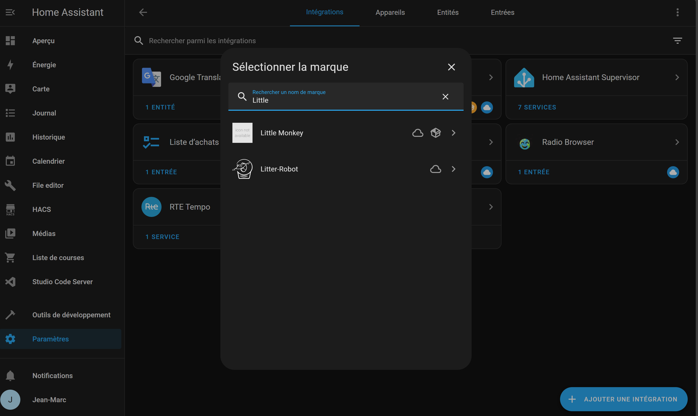
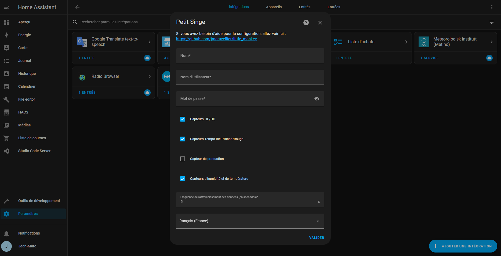
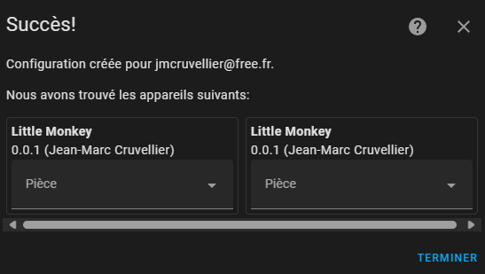

# Installation & Configuration

## Installation pas à pas

1. Cliquer sur le lien d'installation, saisir l'adresse de votre instance Home Assistant, puis cliquer sur "Open Link":


2. Cliquer sur le bouton "Ajouter":


3. Cliquer sur le bouton "Télécharger" en bas de la page:


4. Cliquer sur le bouton "Télécharger":



5. L'intégration "Little Monkey" apparaît dans le Home Assistant Community Store (HACS):


6. Il est nécessaire de redémarrer Home Assistant pour que l'intégration fonctionne:
  - Aller dans "Paramètres":

  

  - Cliquer sur le message "Restart required" puis sur le bouton "Valider":

  

7. Le redémarrage est lancé:
  


## Configuration

Une fois Home Assistant redémarré, l'intégration peut maintenant être configurée.

1.  Aller dans "Paramètres", "Appareils et Services" et dans l'onglet "Intégrations" cliquer sur le bouton "Ajouter une Intégration". Rechercher "Little Monkey" et cliquer dessus:



2. Premier écran, votre compte :
  - Nom: nom qui sera utilisé pour préfixer les noms de tous les capteurs
  - Nom d'utilisateur et Mot de passe: vos identifiants ecojoko<sup>©️</sup>

  Le bouton Suivant vérifie vos identifiants et lit le contrat d'électricité renseigné dans ecojoko<sup>©️</sup>.

3. Deuxième écran, les tranches tarifaires de votre contrat (Heures Pleines/Creuses, Tempo Bleu/Blanc/Rouge, Semaine/Week-end, Jour Spécial…), trouvées automatiquement :
  - Capteurs totaux HC et HP: crée les capteurs « Consommation HC Réseau » et « Consommation HP Réseau », qui additionnent les tranches de chaque catégorie
  - Pour chaque tranche : le nom de son capteur (prérempli) et le total dans lequel elle compte (Heures Creuses, Heures Pleines, ou aucun). Une tranche qu'ecojoko<sup>©️</sup> renomme garde son capteur et le nom que vous avez choisi

4. Troisième écran, les autres capteurs :
  - Capteur de production: à ne sélectionner que si vous êtes producteur d'énergie solaire et que vous avez un capteur ecojoko<sup>©️</sup> ancienne génération
  - Capteurs d'humidité et de température: à ne sélectionner que si vous désirez remonter ces données depuis votre ecojoko<sup>©️</sup>
  - Activité du compte : économies, consommation et coût sur 7 jours, économies cumulées et puissances maximales ; elles alimentent les faces 2 à 4 et l'aiguille du bas de la carte « Little Monkey »
  - Économies : coûts et économies sur 12 mois, économies de la semaine, du mois et de l'année ; nécessaire aux cartes des économies
  - Contrat : l'offre, les tranches et le prix d'un kWh ; nécessaire à la carte « Contrat »
  - Équipements pilotés : les appareils, capteurs et le pilotage des équipements (chauffe-eau…) ; nécessaire à la carte « Équipements »
  - Analyse de la conso : la répartition par poste et les activations des appareils, lues à la demande ; nécessaire aux cartes « Analyse de la conso » et « Activations »
  - Mesures : la puissance du jour, l'énergie par tranche, la température et l'humidité, lues à la demande ; nécessaire à la carte « Mesures »

  Ces six options, apparues avec la version 2.0.0, sont décochées par défaut : leurs capteurs ne sont créés, et leurs données lues chez ecojoko, que si elles sont cochées. Décocher une option supprime ses capteurs. Les options Analyse de la conso et Mesures n'ont pas de capteurs : sans elles, leurs services répondent `enabled: false` sans rien lire chez ecojoko. Une carte dont l'option est décochée l'indique et invite à l'activer.
  - Fréquence de rafraîchissement des données (en secondes): le minimum autorisé est de 3 secondes (afin de ne pas surcharger les serveurs d'ecojoko<sup>©️</sup>), et le maximum est de 60 secondes

Les options reprennent les mêmes écrans : après un changement de contrat, ouvrez-les pour retrouver les tranches du nouveau contrat.

> [!NOTE]
> Une installation existante est convertie automatiquement : les capteurs HC/HP et Tempo gardent leurs identifiants, leur historique et leurs statistiques. Pour un autre contrat (Week-end, Jour Spécial…), ouvrez les options pour créer les capteurs de ses tranches.

> [!IMPORTANT]
> Un changement de nom après la première configuration renomme l'appareil et le nom affiché des capteurs. Depuis la version 1.2.8, les capteurs eux-mêmes sont conservés, avec leurs identifiants et leur historique

> [!NOTE]
> Les noms des capteurs suivent la langue de votre instance Home Assistant (français, anglais ou portugais ; anglais pour les autres langues). Depuis la version 1.2.8 il n'y a plus de choix de langue dans ce formulaire, et le formulaire tient désormais sur trois écrans, contrairement à ce que montre la capture d'écran ci-dessous.



3. La configuration est terminée:



4. Voici un exemple de tous les capteurs créés:


## Carte du tableau de bord

Depuis la version 2.0.0, l'intégration fournit la carte « Little Monkey ». Elle est chargée automatiquement par Home Assistant : il n'y a pas de ressource Lovelace à ajouter, ni de dépôt HACS supplémentaire à installer. Elle nécessite Home Assistant 2024.7 ou plus récent.

Elle reprend le cadran du boîtier ecojoko<sup>©️</sup> :

- l'arc supérieur montre la puissance en temps réel sur une échelle logarithmique (0, 50, 100, 500, 1K, 5K, 10K, MAX), en zones de plus en plus marquées (0-100 W, 100 W-1K, 1K-5K, 5K-MAX), avec une aiguille rattachée au disque et de sa couleur ;
- le disque central affiche la puissance en W, la puissance apparente en VA en dessous quand le capteur Puissance Apparente existe, et la courbe des 3 dernières minutes (réglable), lissée ;
- l'aiguille bleu clair de l'arc inférieur indique vos économies sur 7 jours par rapport à votre consommation de référence, de -20 % (côté vert, économie) à +20 % (surconsommation), d'après le capteur Économies sur 7 Jours ; elle reste en butée au-delà, et n'apparaît pas tant qu'ecojoko n'a pas de semaine de référence.

Comme sur le cadran d'ecojoko<sup>©️</sup>, le disque central a plusieurs faces. On passe de l'une à l'autre en glissant le doigt (ou la souris) sur le cadran, ou en touchant les points en bas du disque :

1. la puissance temps réel, décrite ci-dessus ; le titre devient « INJECTION RÉSEAU » quand la puissance est négative (surplus de production injecté), et le disque passe alors au vert ;
2. les économies sur 7 jours, en %, par rapport à votre consommation de référence (« SURCONSOMMATION » quand elles sont positives) ;
3. le coût et la consommation sur 7 jours, avec la consommation de chaque jour en histogramme ;
4. la puissance maximale du mois en cours, de l'année en cours et depuis le début.

Les faces 2 à 4 n'apparaissent qu'avec les capteurs de l'activité du compte (Little Monkey 2.0.0 ou plus récent). Après le choix d'une autre face, la carte revient d'elle-même sur la puissance temps réel au bout de 30 secondes (option `return_seconds`, 0 pour rester sur la face choisie).

Le disque central est bleu ecojoko<sup>©️</sup> par défaut. Si l'option Capteurs HP/HC ou Capteurs Tempo est cochée dans l'intégration, il prend la couleur de la période en cours :

| Période | HC | HP |
| ------- | -- | -- |
| HC/HP (sans Tempo) et Tempo Bleu | bleu foncé `#00008B` | bleu `#0000FF` |
| Tempo Blanc | gris clair `#D3D3D3` | blanc `#FFFFFF` |
| Tempo Rouge | rouge foncé `#8B0000` | rouge `#FF0000` |

La carte utilise par défaut le capteur Période Tarifaire en Cours de l'intégration, créé avec l'option HC/HP ou Tempo. Ce capteur déduit la période du compteur d'énergie qui augmente : il la connaît avec quelques minutes de retard au changement de période. Si vous disposez d'une source plus réactive (intégration RTE Tempo, téléinformation du compteur Linky...), indiquez-la dans la carte. Sont compris les états `HC` / `HP` (ou « Heures Creuses », « off-peak »...), la couleur Tempo en français ou en anglais (`Bleu`, `white`...), les deux ensemble (`HC Bleu`, `hp_red`), les périodes du compteur Linky (`HCJB`, `HPJR`...) et un capteur binaire allumé pendant les heures creuses. Sans période connue, le disque reste bleu ecojoko<sup>©️</sup> ; une couleur Tempo connue sans période donne sa couleur HP. Sous la courbe, la carte affiche aussi le nom de la période en cours, par exemple « HEURES CREUSES » ou « HEURES PLEINES · JOUR ROUGE ».

Pour l'ajouter, modifier un tableau de bord, cliquer sur "Ajouter une carte" et chercher "Little Monkey" (ou "Petit Singe"). L'éditeur visuel choisit automatiquement les capteurs Consommation Temps Réel, Puissance Apparente et Période Tarifaire en Cours de votre appareil Little Monkey ; il ne propose la période tarifaire que si l'option HC/HP ou Tempo est cochée dans l'intégration, et la couleur Tempo que pour l'option Tempo.

Vous pouvez aussi utiliser la configuration YAML suivante, en remplaçant les entités par les vôtres :

```yaml
type: custom:little-monkey-card
entity: sensor.ecojoko_consommation_temps_reel
# Facultatif : entité donnant la période en cours (HC/HP, Tempo, Linky),
# par défaut le capteur Période Tarifaire en Cours de l'appareil
tariff_entity: binary_sensor.heures_creuses
# Facultatif : entité donnant la couleur Tempo du jour, si tariff_entity ne la donne pas
tempo_color_entity: sensor.couleur_tempo_actuelle
```

| Option | Obligatoire | Description |
| ------ | ----------- | ----------- |
| `entity` | Oui | Capteur Consommation Temps Réel de Little Monkey |
| `apparent_power_entity` | Non | Capteur de puissance apparente ; par défaut le capteur Puissance Apparente du même appareil Little Monkey, s'il existe |
| `tariff_entity` | Non | Entité donnant la période en cours (HC/HP, et éventuellement la couleur Tempo) ; par défaut le capteur Période Tarifaire en Cours du même appareil Little Monkey |
| `tempo_color_entity` | Non | Entité donnant la couleur Tempo du jour, prioritaire sur `tariff_entity` pour la couleur |
| `max_power` | Non | Puissance en W de la graduation MAX (12000 par défaut, au moins 10001) |
| `relief` | Non | Relief du cadran comme sur l'application ecojoko : ombre autour du cadran, lunette creusée et ombre sous le disque (`true` par défaut, `false` pour un cadran plat) |
| `dial_color` | Non | Couleur de l'intérieur du cadran : `default` (par défaut, une teinte tirée du thème, un peu plus claire que la carte en thème sombre et un peu grisée en thème clair), `none` (transparent) une couleur de la palette de Home Assistant (`light-blue`, `amber`, `grey`...), qui suit le thème, ou une couleur libre (`[30, 40, 50]` comme le donne le sélecteur de couleur, ou `"#1e2832"`) ; dans l'éditeur, le menu « Fond du cadran » propose ces quatre choix. Sur une couleur de la palette ou libre, les graduations passent en foncé ou en clair pour rester lisibles |
| `return_seconds` | Non | Délai en secondes avant le retour sur la face de la puissance temps réel (30 par défaut, 0 pour rester sur la face choisie) |
| `savings_entity` | Non | Capteur des économies sur 7 jours en %, pour l'aiguille du bas ; par défaut le capteur Économies sur 7 Jours du même appareil Little Monkey |
| `trend_minutes` | Non | Durée de la courbe du disque central, en minutes (3 par défaut, comme le cadran d'ecojoko ; de 1 à 60) |

La carte détecte seule les options HC/HP et Tempo, d'après les capteurs du même appareil Little Monkey.

> [!TIP]
> Après une mise à jour de l'intégration, si la carte n'apparaît pas ou n'a pas changé, actualisez la page en vidant le cache du navigateur (Ctrl+F5), et sur l'application mobile videz le cache du frontend depuis les paramètres de l'application.

## Cartes des économies

L'intégration fournit aussi deux cartes qui reprennent l'onglet « Économies » de l'application ecojoko<sup>©️</sup>. Comme la carte du cadran, elles sont chargées automatiquement : cherchez « Petit Singe » (« Little Monkey » en anglais) ou « économies » dans le choix des cartes. Elles s'appuient sur les capteurs des économies (Little Monkey 2.0.0 ou plus récent), que leur éditeur visuel choisit seul.

### Résumé des économies

Trois barres pour les 12 derniers mois : la consommation en cours, la consommation de référence et les économies (« Surconsommation », en orange, quand elles sont négatives). Les barres sont proportionnelles, et toucher une ligne ouvre l'historique de son capteur.

```yaml
type: custom:little-monkey-savings-summary-card
entity: sensor.ecojoko_economies_sur_12_mois
# Facultatif : unité, euros (eur, par défaut) ou kWh (kwh)
unit: eur
# Facultatif : titre, « Économies » par défaut
title: Économies
```

| Option | Obligatoire | Description |
|---|---|---|
| `entity` | Oui | Capteur Économies sur 12 Mois |
| `consumption_entity` | Non | Capteur du coût de la consommation sur 12 mois ; par défaut celui du même appareil Little Monkey |
| `reference_entity` | Non | Capteur du coût de référence sur 12 mois ; par défaut celui du même appareil Little Monkey |
| `unit` | Non | `eur` (par défaut) ou `kwh` |
| `title` | Non | Titre de la carte |

### Détail des économies

Les économies d'une semaine (jour par jour), d'un mois (semaine par semaine) ou d'une année (mois par mois), en barres : vertes pour une économie, gris-bleu pour une surconsommation.

- les boutons Semaine / Mois / Année changent de période ; le total de la période, en euros et en kWh, s'affiche à côté ;
- les flèches en bas, ou un glissement du doigt sur les barres, passent à la période précédente ou suivante ; la période en cours vient des capteurs, les précédentes sont lues chez ecojoko par le service `little_monkey.get_savings` ;
- toucher une barre affiche son détail (par exemple « Lundi 16 novembre : -0,35 € · -2,58 kWh ») ; une semaine est nommée par ses jours, par exemple « 9–15 nov. 2026 ».

```yaml
type: custom:little-monkey-savings-detail-card
entity: sensor.ecojoko_economies_de_la_semaine
# Facultatif : période affichée d'abord, week (par défaut), month ou year
period: week
# Facultatif : unité des barres, euros (eur, par défaut) ou kWh (kwh)
unit: eur
```

| Option | Obligatoire | Description |
|---|---|---|
| `entity` | Oui | Capteur Économies de la Semaine (ou du Mois, ou de l'Année) : la carte trouve les deux autres sur le même appareil Little Monkey |
| `period` | Non | `week` (par défaut), `month` ou `year` |
| `unit` | Non | Unité des barres : `eur` (par défaut) ou `kwh` |
| `title` | Non | Titre de la carte |

## Carte du contrat

La carte « Petit Singe : contrat » (« Little Monkey contract » en anglais) résume votre contrat d'électricité d'après le capteur Contrat :

- le fournisseur, l'offre, sa date de début et la puissance souscrite ;
- un cadran des 24 heures avec les heures creuses du contrat et une aiguille sur l'heure actuelle, la période en cours et le prochain changement (« Heures pleines à 07:00, dans 1 h 45 ») ; avec un contrat Tempo, le cadran prend la couleur du jour (bleu, blanc ou rouge, plus foncée en heures creuses) ;
- les tranches tarifaires configurées, avec leur badge HC ou HP et le prix d'un kWh, la tranche en cours en gras (toucher une tranche ouvre le capteur de sa consommation du jour), et l'abonnement mensuel.

Le prix d'un kWh est celui qu'ecojoko donne quand il le connaît : c'est le tarif affiché sous « Votre tarif d'électricité » dans la fiche du chauffe-eau de son application. ecojoko ne le donne qu'avec un chauffe-eau piloté, et pas pour toutes les offres : la fiche affiche parfois le fournisseur et l'offre sans aucun prix. Sinon, le prix est estimé, précédé de « ≈ », à partir des coûts qu'ecojoko calcule chaque jour pour chaque tranche sur les deux dernières semaines. Ces coûts comprennent une part de l'abonnement, que l'estimation écarte ; ecojoko les arrondissant au centime, elle est donnée au dixième de centime près. Une tranche qui n'a pas assez servi pour l'estimer (un jour rouge Tempo, par exemple) affiche sa consommation du jour à la place.

```yaml
type: custom:little-monkey-contract-card
entity: sensor.ecojoko_contrat
```

| Option | Obligatoire | Description |
|---|---|---|
| `entity` | Oui | Capteur Contrat de l'appareil Little Monkey |
| `title` | Non | Titre affiché au-dessus du contrat |

## Service « Lire les économies »

Le service `little_monkey.get_savings` renvoie les économies d'une semaine, d'un mois ou d'une année, comme la page « Détail des économies » d'ecojoko. La carte « Détail des économies » s'en sert pour remonter dans le temps ; vous pouvez aussi l'appeler depuis un script ou une automatisation :

```yaml
action: little_monkey.get_savings
data:
  period: month        # week, month ou year
  date: "2026-10-15"   # facultatif : un jour de la période, aujourd'hui par défaut
  # config_entry_id: … # facultatif s'il n'y a qu'une installation Little Monkey
response_variable: economies
```

La réponse reprend les attributs des capteurs Économies de la Semaine / du Mois / de l'Année : `savings` (en euros, négatives en cas de surconsommation), `savings_kwh`, `cost`, `consumption`, `reference_cost`, `reference_consumption`, `start`, `missing_data`, et `bars`, le détail par jour, semaine ou mois.

## Cartes de l'analyse de la consommation

Ces cartes reprennent la page « Analyse de votre conso » de l'application ecojoko<sup>©️</sup>. Chargées automatiquement comme les autres, elles se trouvent en cherchant « Petit Singe » (« Little Monkey » en anglais) ou « analyse » dans le choix des cartes. Elles lisent leurs données chez ecojoko à l'affichage, avec les services décrits plus bas : elles ne créent pas de capteur.

### Analyse de la conso

La consommation d'une semaine ou d'un mois par poste, comme la page « Analyse de votre conso » d'ecojoko, qui n'analyse pas les années : un anneau coloré avec le total au centre et, à côté (au-dessus sur une carte étroite), les principaux postes (talon de consommation, éclairage, froid, cuisson…) sur une ligne chacun, avec leur part, leur coût et une flèche quand ils sont en hausse ou en baisse par rapport à la période précédente. Seuls les 5 plus gros postes sont affichés d'abord : « Afficher les N postes » déplie la liste complète (option `max_categories`). La flèche › de « Gros électroménager » affiche son détail (lave-vaisselle, lavage et séchage du linge). Toucher un poste affiche son historique : sa consommation semaine par semaine sur l'année, avec le total ; les flèches changent d'année, toucher une barre affiche sa semaine, et ‹ revient aux postes.

ecojoko analyse une période une fois qu'elle est terminée : la carte s'ouvre sur la dernière semaine (ou le dernier mois) analysée, et les flèches ou un glissement du doigt remontent dans le temps. Une période pas encore analysée affiche l'explication d'ecojoko.

```yaml
type: custom:little-monkey-analysis-card
entity: sensor.ecojoko_consommation_temps_reel
# Facultatif : période affichée d'abord, week (par défaut), month ou year
period: week
```

| Option | Obligatoire | Description |
|---|---|---|
| `entity` | Oui | Un capteur de l'appareil Little Monkey, qui désigne l'installation |
| `period` | Non | `week` (par défaut), `month` ou `year` |
| `max_categories` | Non | Nombre de postes affichés avant de déplier la liste : 5 par défaut, 0 pour tous |
| `title` | Non | Titre de la carte |

### Activations des appareils

Les démarrages d'appareils détectés par ecojoko sur 48 heures, en une frise de 24 heures par jour : chaque activation y est une impulsion à son heure, aussi large qu'elle dure et aussi haute que sa puissance, à la couleur d'ecojoko. Toucher une impulsion affiche ses heures, sa durée, son énergie et sa puissance moyenne (la dernière activation au départ) ; les flèches passent aux 48 heures précédentes ou suivantes. La carte se met à jour toutes les dix minutes. Avec `mode: list`, elle affiche à la place la liste des 8 dernières activations, que « Voir plus » complète.

```yaml
type: custom:little-monkey-activations-card
entity: sensor.ecojoko_consommation_temps_reel
# Facultatif : timeline (une frise par jour, par défaut) ou list
mode: timeline
```

| Option | Obligatoire | Description |
|---|---|---|
| `entity` | Oui | Un capteur de l'appareil Little Monkey, qui désigne l'installation |
| `mode` | Non | `timeline` (par défaut) ou `list` |
| `title` | Non | Titre de la carte |

## Services de l'analyse de la consommation

Trois services renvoient les données de la page « Analyse de votre conso » d'ecojoko. Les cartes de l'analyse s'en servent ; vous pouvez aussi les appeler depuis un script ou une automatisation (`response_variable`). Comme pour les autres services, `config_entry_id` est facultatif s'il n'y a qu'une installation Little Monkey.

| Service | Champs | Réponse |
|---|---|---|
| `little_monkey.get_consumption_analysis` | `period` (`week` ou `month`), `date` facultative | La répartition de la consommation par poste (talon, éclairage, froid…) : `cost`, `consumption`, et `categories`, chacune avec `id`, `name`, `color`, `cost`, `consumption`, `percentage`, `trend` (`up` ou `down`) et ses sous-postes (`children`). Sans date, la dernière période analysée par ecojoko. Une période pas encore analysée renvoie `available: false` et le message d'ecojoko (`message`) |
| `little_monkey.get_category_history` | `category` (l'`id` d'un poste), `date` facultative | La consommation du poste semaine par semaine sur l'année de la date (`bars` : `date`, `cost`, `consumption`, `percentage`) |
| `little_monkey.get_activations` | `page` facultative (0 par défaut) | Les démarrages d'appareils détectés sur 48 heures (page 0 : les 48 dernières heures, page 1 : les 48 heures précédentes…) : `activations`, chacune avec `start`, `end`, `power` (W moyen), `energy` (kWh) et la forme dessinée par ecojoko (`shape`) |

## Équipements

Chaque équipement piloté par ecojoko (chauffe-eau, prise pilotée…) devient un appareil de Home Assistant, rattaché à l'appareil Little Monkey, avec ses capteurs : mode, puissance, et consommation et coût du jour s'il mesure sa consommation. Chaque équipement a aussi ses capteurs de diagnostic quand ecojoko donne leur valeur (connexion à l'assistant ecojoko, force de cette connexion, connexion au WiFi et batterie, lus toutes les cinq minutes, avec les mots de la fiche de l'équipement dans ecojoko) : sur l'appareil de l'équipement piloté, sur l'appareil Little Monkey pour les autres (« Clé Linky : force de la connexion »…). Son état et ses mesures sont lus toutes les deux minutes, à part des autres capteurs : une panne de ces API ne touche jamais les capteurs de consommation. Un équipement ajouté dans ecojoko apparaît après un rechargement de l'intégration ; l'appareil d'un équipement retiré, ou qui n'est plus piloté, est supprimé au démarrage suivant.

L'intégration ne connaît pas à l'avance les types d'équipements : elle lit pour chacun les commandes qu'ecojoko lui reconnaît. Un équipement d'un type inconnu est donc pris en charge dès qu'il accepte les commandes de pilotage.

### Pilotage

Un équipement piloté a une liste « Pilotage » qui reprend les boutons de l'application ecojoko :

| Choix | Effet |
|---|---|
| Automatique | L'équipement suit de nouveau sa programmation dans ecojoko (bouton « Automatique » d'ecojoko) |
| Forcé | L'équipement est allumé pendant une heure, puis revient seul en automatique |
| Absence | L'équipement est éteint jusqu'à minuit, puis revient seul en automatique |
| Allumé, Éteint | Pour un équipement sans mode forcé, les boutons « Allumer » et « Éteindre » d'ecojoko |

Le service « Piloter un équipement » (`little_monkey.set_equipment_mode`) choisit la durée, par exemple dans une automatisation :

| Champ | Obligatoire | Description |
|---|---|---|
| `device_id` | Oui | L'appareil de l'équipement piloté |
| `mode` | Oui | `auto`, `forced`, `absence`, ou `on` et `off` pour un équipement sans mode forcé |
| `duration` | Non | Durée du mode forcé (une heure par défaut, au plus 24 heures) ou de l'absence, en minutes |
| `until` | Non | Fin de l'absence (date et heure), à la place de la durée ; une absence demande l'une ou l'autre |

```yaml
action: little_monkey.set_equipment_mode
data:
  device_id: 0123456789abcdef  # l'appareil du chauffe-eau
  mode: forced
  duration: 90
```

ecojoko accepte des durées que son application ne propose pas (un forçage de 30 minutes, une absence jusqu'à une heure précise). L'état de l'équipement est relu juste après la commande. Si ecojoko ne répond pas, le service renvoie une erreur, mais la commande a pu être appliquée : l'état relu le dit.

### Carte des équipements

La carte « Équipements » reprend l'écran « Équipements » d'ecojoko. Elle est chargée automatiquement, comme les autres cartes ; cherchez « Petit Singe : équipements » dans le sélecteur de cartes.

```yaml
type: custom:little-monkey-equipment-card
entity: sensor.ecojoko_consommation_temps_reel
# Facultatif : un seul équipement piloté, par son nom ou son id ecojoko
equipment: Chauffe-eau
# Facultatif : false pour ne pas lister les équipements non pilotés
show_list: true
# Facultatif : titre, « Équipements » par défaut
title: Équipements
```

| Option | Obligatoire | Description |
|---|---|---|
| `entity` | Oui | Un capteur de l'appareil Little Monkey, qui désigne l'installation |
| `equipment` | Non | Un seul équipement piloté, par son nom ou son id ecojoko : une carte par équipement. La liste des autres équipements n'est alors pas affichée |
| `show_list` | Non | `false` pour ne pas lister les équipements non pilotés (clé Linky, sonde…) |
| `title` | Non | Titre de la carte |

Chaque équipement piloté a son bloc : son mode (« Forcé jusqu'à 21:30 », « Automatique · éteint »…), sa puissance et les boutons d'ecojoko. « Forcé » propose 1, 2, 3 ou 4 heures, ou une autre durée en minutes (24 heures au plus), « Absence » la date et l'heure de retour (minuit par défaut), « Automatique » (affiché pendant un forçage ou une absence) et « Allumer » / « Éteindre » demandent une confirmation ; le bouton dont la question est ouverte apparaît sélectionné, comme Allumer ou Éteindre selon l'état de l'équipement. Ouvert, le bloc montre la consommation et le coût du jour, la tension, la puissance maximale, et la frise de la journée : les périodes allumé, forcé et absent, et la courbe de puissance.

Avec plusieurs équipements pilotés, chaque bloc tient sur une ligne avec ses boutons ; toucher un équipement l'ouvre et referme le précédent, pour que la carte reste basse quel que soit leur nombre. Toucher une valeur (mode, puissance, consommation, coût, tension, frise, température de la sonde…) ouvre ses détails dans Home Assistant, avec son historique, comme dans les autres cartes. Une valeur qui a une entité affiche l'état de cette entité, comme ses détails : la puissance de la clé Linky est celle de Consommation Temps Réel, et non celle de la liste des équipements, qu'ecojoko ne met à jour que toutes les cinq minutes. Les équipements non pilotés sont listés en dessous avec leurs mesures (température et humidité de la sonde, puissance lue par la clé Linky), leur batterie et la force de leur signal, et « Déconnecté » s'ils ne sont plus reliés.

La carte ne connaît pas les types d'équipements : ses boutons sont ceux qu'ecojoko propose pour chacun, et elle n'affiche que les mesures qu'il donne. Un nouvel équipement d'ecojoko y apparaît donc sans mise à jour de la carte.

### Service « Lire les équipements »

`little_monkey.get_equipments` renvoie immédiatement, sans interroger ecojoko, les équipements de l'installation tels que lus en dernier (`equipments`). Chacun a son nom (`name`), son type (`type`), son état de connexion (`connected`, `status`), la force de son signal (`signal`, `wifi_signal`) et sa batterie (`battery`) quand ecojoko les donne, ses commandes de pilotage (`controls`) et son état (`state` : `mode`, `power`, `since`, `until`, `source`, `temperature` et `humidity` pour une sonde…). Chacun a les entités de ses valeurs (`entities` : `mode`, `power`, `energy`, `cost`, `voltage`, `control`, `signal`…, et pour la sonde ou la clé Linky les capteurs de l'appareil Little Monkey qui donnent les mêmes mesures). Un équipement piloté a aussi l'id de son appareil Home Assistant (`device_id`) et ses mesures du jour (`day` : `energy`, `cost`, la courbe de puissance `power` et les changements d'état `switches`). `config_entry_id` est facultatif s'il n'y a qu'une installation Little Monkey.

## Carte des mesures

La carte « Petit Singe : mesures » reprend la page « Mesures » d'ecojoko. Elle est chargée automatiquement, comme les autres cartes.

```yaml
type: custom:little-monkey-measures-card
entity: sensor.ecojoko_consommation_temps_reel
# Facultatif : mesure affichée d'abord, electricity (par défaut), temperature ou humidity
measure: electricity
# Facultatif : période affichée d'abord, day (par défaut), week, month ou year
period: day
# Facultatif : unité des barres, kwh (par défaut) ou eur
unit: kwh
# Facultatif : titre, « Mesures » par défaut
title: Mesures
```

| Option | Obligatoire | Description |
|---|---|---|
| `entity` | Oui | Un capteur de l'appareil Little Monkey, qui désigne l'installation |
| `measure` | Non | Onglet affiché d'abord : `electricity` (par défaut), `temperature` ou `humidity` |
| `period` | Non | Période affichée d'abord : `day` (par défaut), `week`, `month` (30 jours pour l'électricité, comme le « Mois » d'ecojoko ; le mois calendaire pour la température et l'humidité) ou `year` |
| `unit` | Non | Unité des barres : `kwh` (par défaut) ou `eur` |
| `title` | Non | Titre de la carte |

- **Jour :** la courbe de puissance de la journée, colorée selon la tranche tarifaire de chaque instant (heures pleines, heures creuses, couleurs Tempo…) aux couleurs d'ecojoko, avec le talon de consommation en bleu foncé dessous et la production injectée sous l'axe. Toucher la courbe donne la puissance à cette heure.
- **Semaine, Mois, Année :** les jours ou les mois en barres empilées par tranche, en kWh ou en euros, avec la production injectée sous l'axe (en kWh). La légende donne le total de chaque tranche sur la période ; toucher une barre affiche son détail.
- **Température, Humidité :** les courbes intérieure et extérieure de la période, avec la moyenne intérieure en haut ; toucher la courbe donne les deux valeurs à cet instant. Elles viennent des statistiques de Home Assistant quand les capteurs de température et d'humidité existent (option de l'intégration) et qu'elles couvrent toute la période, et la légende ouvre alors ces capteurs. Sinon elles sont lues chez ecojoko, qui a tout l'historique de la sonde : les statistiques de Home Assistant ne remontent qu'à la création des capteurs, et celles d'une journée ne sont gardées que dix jours.
- En haut, l'énergie et le coût de la période pour l'électricité ; les onglets changent de mesure, les flèches ou un glissement du doigt changent de période.

## Service « Lire les mesures »

`little_monkey.get_measures` renvoie les mesures d'une période, comme la page « Mesures » d'ecojoko. `config_entry_id` est facultatif s'il n'y a qu'une installation Little Monkey.

| Champ | Obligatoire | Description |
|---|---|---|
| `measure` | Oui | `electricity`, `temperature` ou `humidity` |
| `period` | Oui | `day`, `week`, `month` ou `year`. Pour l'électricité, le mois est formé des 30 jours qui finissent à la date, comme le « Mois » d'ecojoko ; pour la température et l'humidité, c'est le mois calendaire, le seul que la sonde connaisse |
| `date` | Non | Un jour de la période, aujourd'hui par défaut |

La réponse donne le début de la période (`start`) et celui des périodes précédente et suivante (`previous`, `next`). Pour l'électricité, elle donne aussi l'énergie (`energy`), le coût (`cost`), la production injectée (`production`) et les tranches tarifaires avec leur couleur (`bands`). Un jour a sa puissance toutes les quelques minutes (`points` : `time`, `power`, le talon `base` et la tranche `band`). Une semaine, un mois ou une année a ses jours ou ses mois (`bars` : `date`, `energy`, `cost`, `base_energy`, `production` et le détail par tranche `bands`). Pour la température et l'humidité, elle donne l'unité (`unit`) et les mesures intérieure et extérieure (`points` : `time`, `inside`, `outside`).
