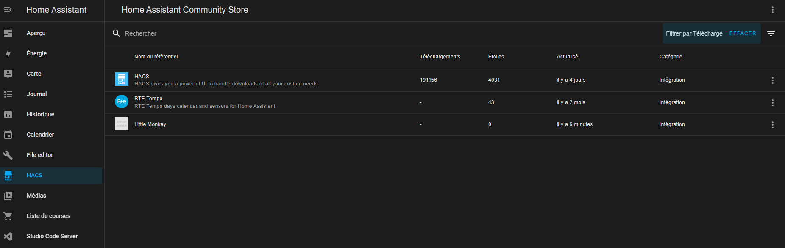
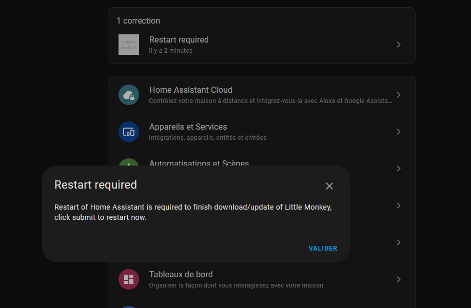
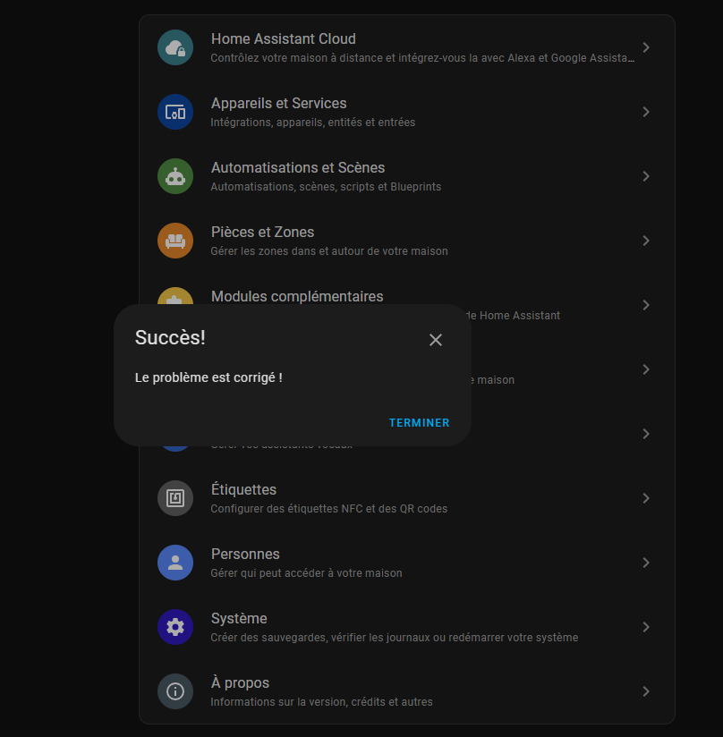
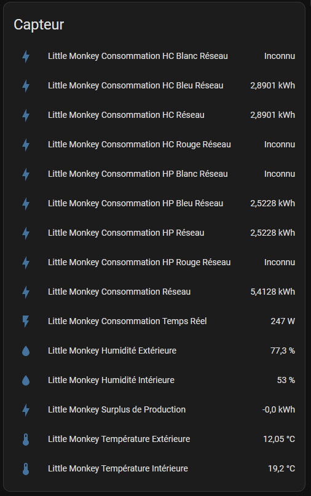

# Installation & Configuration

## Installation pas à pas

1. Cliquer sur le lien d'installation, saisir l'adresse de votre instance Home Assistant, puis cliquer sur "Open Link":


2. Cliquer sur le bouton "Ajouter":


3. Cliquer sur le bouton "Télécharger" en bas de la page:


4. Cliquer sur le bouton "Télécharger":


5. L'intégration "Little Monkey" apparaît dans le Home Assistant Community Store (HACS):



6. Il est nécessaire de redémarrer Home Assistant pour que l'intégration fonctionne:
  - Aller dans "Paramètres":

  

  - Cliquer sur le message "Restart required" puis sur le bouton "Valider":

  

7. Le redémarrage est lancé:
  


## Configuration

Une fois Home Assistant redémarré, l'intégration peut maintenant être configurée.

1.  Aller dans "Paramètres", "Appareils et Services" et dans l'onglet "Intégrations" cliquer sur le bouton "Ajouter une Intégration". Rechercher "Little Monkey" et cliquer dessus:


2. Saisir et Sélectionner les options de configurations:
  - Nom: nom qui sera utilisé pour préfixer les noms de tous les capteurs
  - Nom d'utilisateur et Mot de passe: vos identifiants ecojoko<sup>©️</sup>
  - Capteurs HP/HC: à ne sélectionner que si vous avez renseigné un tarif d'électricité avec des Heures Creuses dans ecojoko<sup>©️</sup>
  - Capteurs Tempo Bleu/Blanc/Rouge: à ne sélectionner que si vous avez renseigné un tarif d'électricité Tempo
  - Capteurs d'humidité et de température: à ne sélectionner que si vous désirez remonter ces données depuis votre ecojoko<sup>©️</sup>
  - Capteur de production: à ne sélectionner que si vous êtes producteur d'énergie solaire et que vous avez un capteur ecojoko<sup>©️</sup> ancienne génération
  - Fréquence de rafraîchissement des données (en secondes): le minimum autorisé est de 3 secondes (afin de ne pas surcharger les serveurs d'ecojoko<sup>©️</sup>), et le maximum est de 60 secondes

> [!IMPORTANT]
> Un changement de nom après la première configuration renomme l'appareil et le nom affiché des capteurs. Depuis la version 1.2.8, les capteurs eux-mêmes sont conservés, avec leurs identifiants et leur historique

> [!NOTE]
> Les noms des capteurs suivent la langue de votre instance Home Assistant (français, anglais ou portugais ; anglais pour les autres langues). Depuis la version 1.2.8 il n'y a plus de choix de langue dans ce formulaire, contrairement à ce que montre la capture d'écran ci-dessous.


3. La configuration est terminée:


4. Voici un exemple de tous les capteurs créés:



## Carte du tableau de bord

Depuis la version 1.3.0, l'intégration fournit la carte « Little Monkey ». Elle est chargée automatiquement par Home Assistant : il n'y a pas de ressource Lovelace à ajouter, ni de dépôt HACS supplémentaire à installer. Elle nécessite Home Assistant 2024.7 ou plus récent.

Elle reprend le cadran du boîtier ecojoko<sup>©️</sup> :

- l'arc supérieur montre la puissance en temps réel sur une échelle logarithmique (0, 50, 100, 500, 1K, 5K, 10K, MAX), en zones de plus en plus marquées (0-100 W, 100 W-1K, 1K-5K, 5K-MAX), avec une aiguille rattachée au disque et de sa couleur ;
- le disque central affiche la puissance en W, la puissance apparente en VA en dessous quand le capteur Puissance Apparente existe, et la courbe des 10 dernières minutes (réglable), lissée ;
- l'arc inférieur est pour l'instant décoratif.

Le disque central est bleu ecojoko<sup>©️</sup> par défaut. Si l'option Capteurs HP/HC ou Capteurs Tempo est cochée dans l'intégration, il prend la couleur de la période en cours :

| Période | HC | HP |
| ------- | -- | -- |
| HC/HP (sans Tempo) et Tempo Bleu | bleu foncé `#00008B` | bleu `#0000FF` |
| Tempo Blanc | gris clair `#D3D3D3` | blanc `#FFFFFF` |
| Tempo Rouge | rouge foncé `#8B0000` | rouge `#FF0000` |

La carte utilise par défaut le capteur Période Tarifaire en Cours de l'intégration, créé avec l'option HC/HP ou Tempo. Ce capteur déduit la période du compteur d'énergie qui augmente : il la connaît avec quelques minutes de retard au changement de période. Si vous disposez d'une source plus réactive (intégration RTE Tempo, téléinformation du compteur Linky...), indiquez-la dans la carte. Sont compris les états `HC` / `HP` (ou « Heures Creuses », « off-peak »...), la couleur Tempo en français ou en anglais (`Bleu`, `white`...), les deux ensemble (`HC Bleu`, `hp_red`), les périodes du compteur Linky (`HCJB`, `HPJR`...) et un capteur binaire allumé pendant les heures creuses. Sans période connue, le disque reste bleu ecojoko<sup>©️</sup> ; une couleur Tempo connue sans période donne sa couleur HP. Sous la courbe, la carte affiche aussi le nom de la période en cours, par exemple « HEURES CREUSES » ou « HEURES PLEINES · JOUR ROUGE ».

Pour l'ajouter, modifier un tableau de bord, cliquer sur "Ajouter une carte" et chercher "Little Monkey" (ou "Petit Singe"). L'éditeur visuel choisit automatiquement les capteurs Consommation Temps Réel, Puissance Apparente et Période Tarifaire en Cours de votre appareil Little Monkey ; il ne propose la période tarifaire que si l'option HC/HP ou Tempo est cochée dans l'intégration, et la couleur Tempo que pour l'option Tempo.

Vous pouvez aussi utiliser la configuration YAML suivante, en remplaçant les entités par les vôtres :

```yaml
type: custom:little-monkey-card
entity: sensor.ecojoko_consommation_temps_reel
# Facultatif : entité donnant la période en cours (HC/HP, Tempo, Linky),
# par défaut le capteur Période Tarifaire en Cours de l'appareil
tariff_entity: binary_sensor.heures_creuses
# Facultatif : entité donnant la couleur Tempo du jour, si tariff_entity ne la donne pas
tempo_color_entity: sensor.couleur_tempo_actuelle
```

| Option | Obligatoire | Description |
| ------ | ----------- | ----------- |
| `entity` | Oui | Capteur Consommation Temps Réel de Little Monkey |
| `apparent_power_entity` | Non | Capteur de puissance apparente ; par défaut le capteur Puissance Apparente du même appareil Little Monkey, s'il existe |
| `tariff_entity` | Non | Entité donnant la période en cours (HC/HP, et éventuellement la couleur Tempo) ; par défaut le capteur Période Tarifaire en Cours du même appareil Little Monkey |
| `tempo_color_entity` | Non | Entité donnant la couleur Tempo du jour, prioritaire sur `tariff_entity` pour la couleur |
| `max_power` | Non | Puissance en W de la graduation MAX (12000 par défaut, au moins 10001) |
| `trend_minutes` | Non | Durée de la courbe du disque central, en minutes (10 par défaut, de 1 à 60) |

La carte détecte seule les options HC/HP et Tempo, d'après les capteurs du même appareil Little Monkey.

> [!TIP]
> Après une mise à jour de l'intégration, si la carte n'apparaît pas ou n'a pas changé, actualisez la page en vidant le cache du navigateur (Ctrl+F5), et sur l'application mobile videz le cache du frontend depuis les paramètres de l'application.
