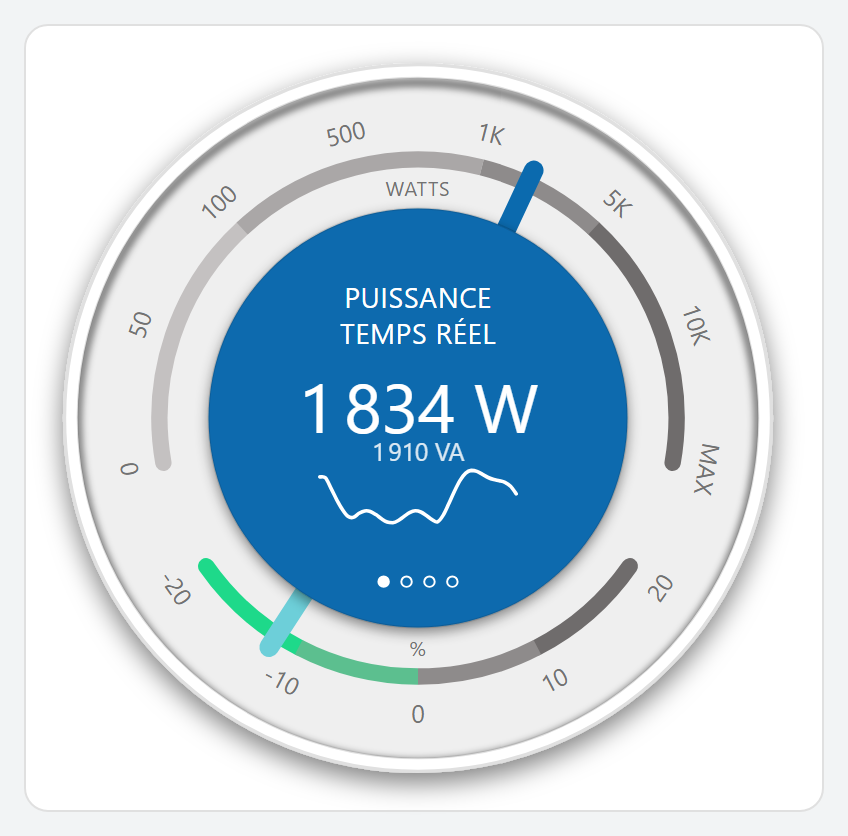
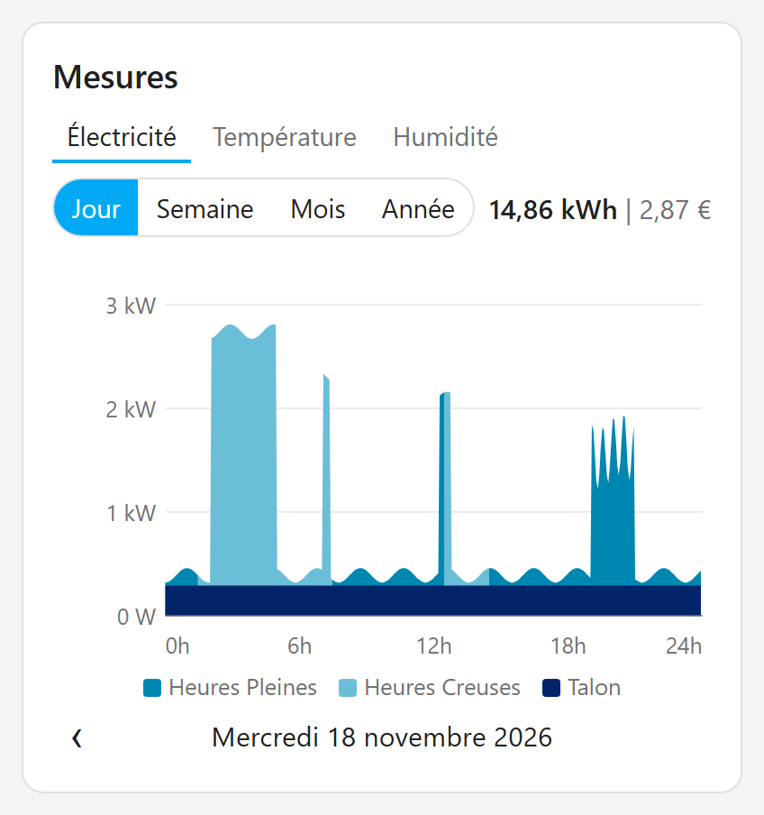
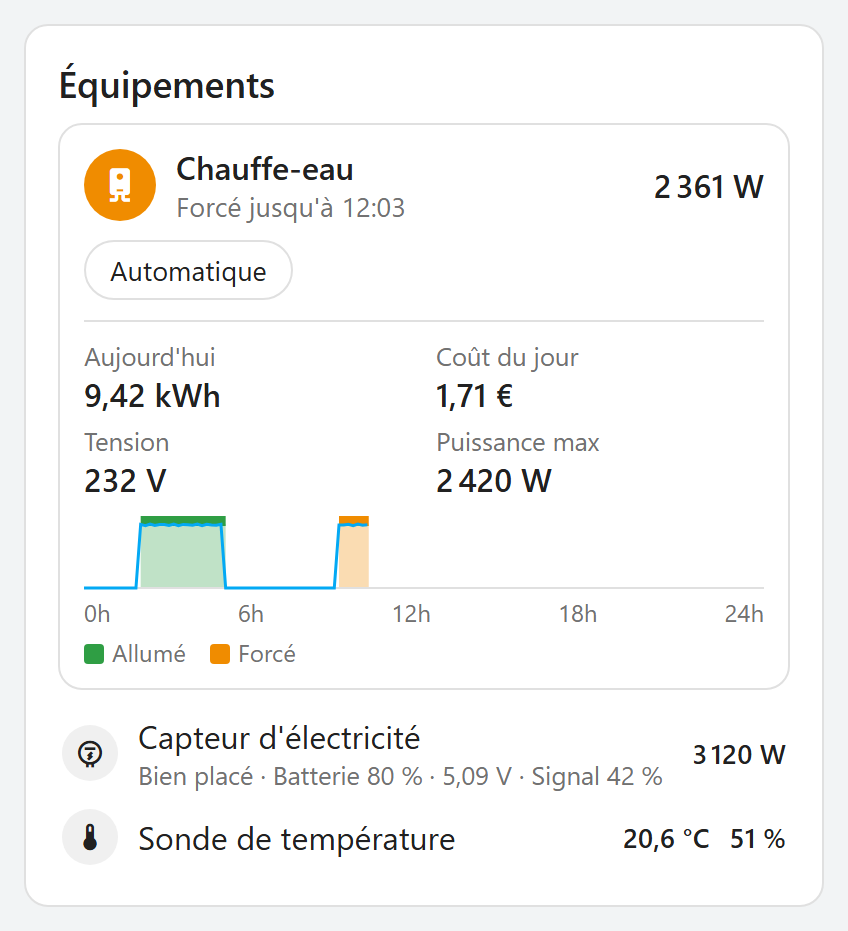
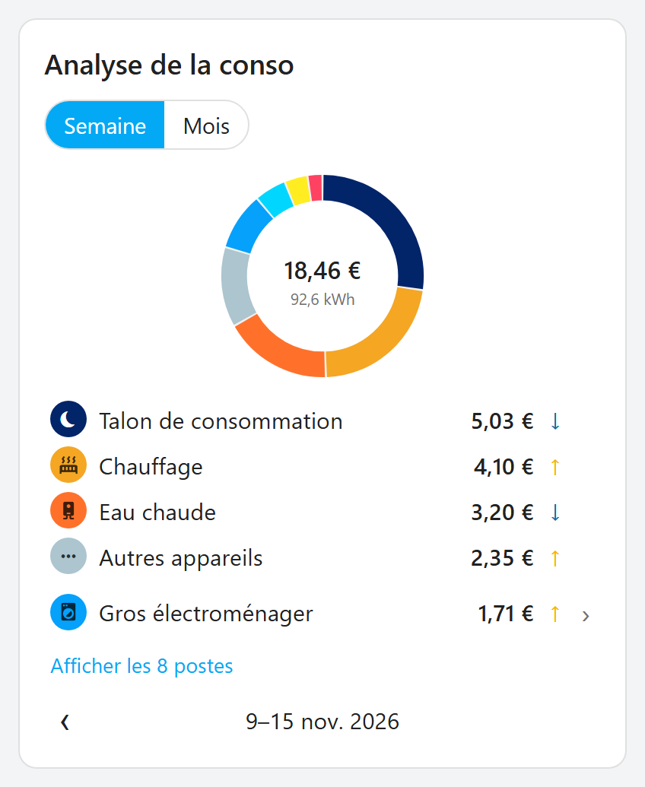

  
  &nbsp;
  

# Little Monkey / Petit Singe

Votre assistant d'énergie ecojoko©️ dans Home Assistant : la consommation en temps réel, l'énergie de chaque tranche tarifaire pour le tableau de bord Énergie, vos économies, votre contrat, le pilotage du chauffe-eau, et des cartes qui reprennent les écrans de l'application ecojoko.

> [!NOTE]
> Vous venez de la version 1.2.8 ? La version 2.0 convertit votre configuration sans perte d'historique, et ses nouvelles fonctions sont à cocher dans les options de l'intégration. Faites une sauvegarde avant de mettre à jour ([nouveautés](https://github.com/jmcruvellier/little_monkey/blob/main/CHANGELOG.md#200)).

## L'intégration

Little Monkey lit vos données sur les serveurs d'ecojoko et crée :

- **les capteurs de base** : puissance en temps réel et apparente, consommation du jour au total et par tranche tarifaire (HC/HP, Tempo, Week-end…), période tarifaire en cours, production injectée, température et humidité ;
- **à la demande**, six groupes de fonctions à cocher dans les options : l'activité du compte (économies et coût sur 7 jours, puissances maximales), les économies (sur 12 mois, la semaine, le mois, l'année), le contrat et le prix du kWh, les équipements pilotés (le chauffe-eau, avec son mode, sa consommation et son pilotage), l'analyse de la consommation par poste et les mesures détaillées ;
- **des services** pour lire ces données détaillées dans vos scripts et automatisations, et piloter un équipement pour la durée de votre choix.

👉 [Tout sur l'intégration](https://github.com/jmcruvellier/little_monkey/blob/main/docs/integration.md) : appareils, capteurs, pilotage, services.

## Les cartes

Huit cartes pour vos tableaux de bord, fournies par l'intégration elle-même, sans autre installation :

<a href="https://github.com/jmcruvellier/little_monkey/blob/main/docs/cartes.md#little-monkey-cadran"><picture><source media="(prefers-color-scheme: dark)" srcset="https://raw.githubusercontent.com/jmcruvellier/little_monkey/main/docs/images/cards/dial-dark.png"></picture></a>
<a href="https://github.com/jmcruvellier/little_monkey/blob/main/docs/cartes.md#mesures"><picture><source media="(prefers-color-scheme: dark)" srcset="https://raw.githubusercontent.com/jmcruvellier/little_monkey/main/docs/images/cards/measures-dark.png"></picture></a>
<a href="https://github.com/jmcruvellier/little_monkey/blob/main/docs/cartes.md#%C3%A9quipements"><picture><source media="(prefers-color-scheme: dark)" srcset="https://raw.githubusercontent.com/jmcruvellier/little_monkey/main/docs/images/cards/equipment-dark.png"></picture></a>
<a href="https://github.com/jmcruvellier/little_monkey/blob/main/docs/cartes.md#analyse-de-la-conso"><picture><source media="(prefers-color-scheme: dark)" srcset="https://raw.githubusercontent.com/jmcruvellier/little_monkey/main/docs/images/cards/analysis-dark.png"></picture></a>

| Carte | Ce qu'elle montre |
|---|---|
| [Little Monkey](https://github.com/jmcruvellier/little_monkey/blob/main/docs/cartes.md#little-monkey-cadran) | Le cadran du boîtier : puissance en temps réel aux couleurs de la période tarifaire, économies, coût et puissances maximales |
| [Contrat](https://github.com/jmcruvellier/little_monkey/blob/main/docs/cartes.md#contrat) | L'offre, les heures creuses sur 24 heures, les tranches et leur prix |
| [Économies](https://github.com/jmcruvellier/little_monkey/blob/main/docs/cartes.md#%C3%A9conomies) | Les économies sur 12 mois |
| [Économies en détail](https://github.com/jmcruvellier/little_monkey/blob/main/docs/cartes.md#%C3%A9conomies-en-d%C3%A9tail) | Les économies jour par jour, semaine par semaine ou mois par mois |
| [Analyse de la conso](https://github.com/jmcruvellier/little_monkey/blob/main/docs/cartes.md#analyse-de-la-conso) | La consommation de la semaine ou du mois par poste |
| [Activations des appareils](https://github.com/jmcruvellier/little_monkey/blob/main/docs/cartes.md#activations-des-appareils) | Les démarrages d'appareils détectés sur 48 heures |
| [Équipements](https://github.com/jmcruvellier/little_monkey/blob/main/docs/cartes.md#%C3%A9quipements) | Le chauffe-eau et son pilotage, les autres équipements ecojoko |
| [Mesures](https://github.com/jmcruvellier/little_monkey/blob/main/docs/cartes.md#mesures) | La courbe de puissance du jour, l'énergie par tranche, la température et l'humidité |

👉 [Tout sur les cartes](https://github.com/jmcruvellier/little_monkey/blob/main/docs/cartes.md) : interactions et options.

## Installation

Il vous faut un assistant ecojoko, vos identifiants [ecojoko](https://service.ecojoko.com/), Home Assistant 2024.7 ou plus récent et le Marketplace (anciennement [HACS](https://hacs.xyz/)).

1. Ajoutez le dépôt au Marketplace et téléchargez Little Monkey :

   

2. Redémarrez Home Assistant.
3. Ajoutez l'intégration Little Monkey dans Paramètres › Appareils et services, et laissez-vous guider.

👉 [Le guide d'installation](https://github.com/jmcruvellier/little_monkey/blob/main/docs/installation.md) : configuration, options, mise à jour depuis la 1.2.8, dépannage.

> [!IMPORTANT]
> Si vous êtes un utilisateur régulier de l'application ecojoko©️, vous n'êtes pas sans savoir que le petit singe glisse souvent sur sa peau de banane. **Cette intégration non officielle dépend des API d'ecojoko©️ et n'est pas responsable de l'indisponibilité de vos données.**

Bienvenue dans la jungle !

## Pourquoi cette intégration ?

Les données de votre compteur sont stockées sur les serveurs d'ecojoko©️, d'où l'application mobile et le site [ecojoko](https://service.ecojoko.com/) les chargent. Suivre sa consommation en temps réel est la première étape pour la réduire ; avec la domotique, on veut aller plus loin : recevoir des alertes selon des seuils de consommation ou de production, lancer des automatisations, profiter du surplus solaire… ecojoko ne proposant pas d'intégration officielle pour Home Assistant, je me suis lancé dans celle-ci.

## Liens utiles

- Contrat Tempo : l'intégration [RTE Tempo](https://github.com/hekmon/rtetempo) d'Edouard Hur donne le calendrier des jours Tempo et des capteurs très utiles, que la carte Little Monkey sait utiliser.
- Panneaux photovoltaïques : Mathieu Carbou propose un boîtier [OpenDTU](https://docs.google.com/document/u/0/d/e/2PACX-1vRaGy2E91kmr014nAi-rfvNxdpZqR6lFIXln1kMKg_T6_YWh72ZNLnwXHxUjQQexczNPZR3GftG7w-r/pub?pli=1) prêt à connecter aux micro-onduleurs, et des [cartes pour Home Assistant](https://gist.github.com/mathieucarbou/70539ced8f330be6205a91897ea1c639#opendtu--home-assistant) pour suivre la production.
- [Contribuer](CONTRIBUTING.md) · [Historique des versions](CHANGELOG.md) · [Signaler un problème](https://github.com/jmcruvellier/little_monkey/issues)
