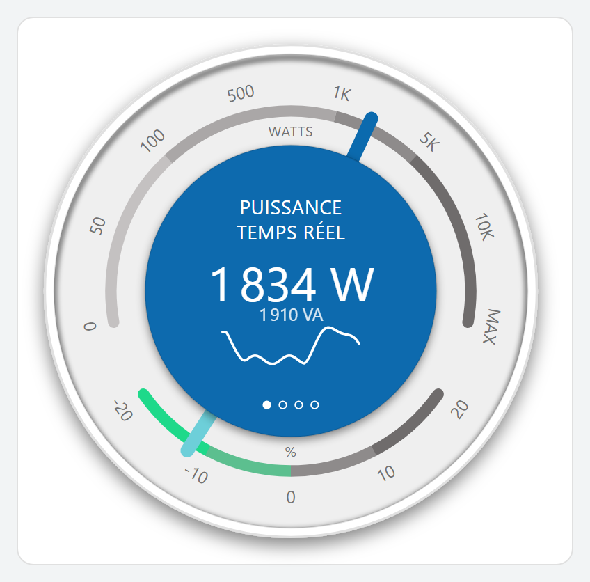
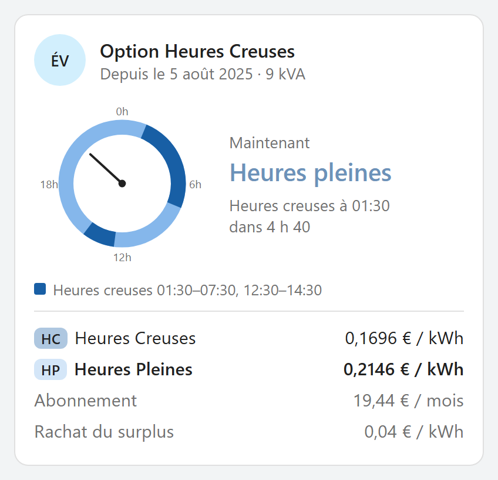
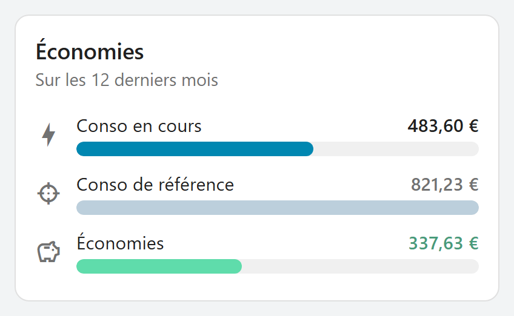
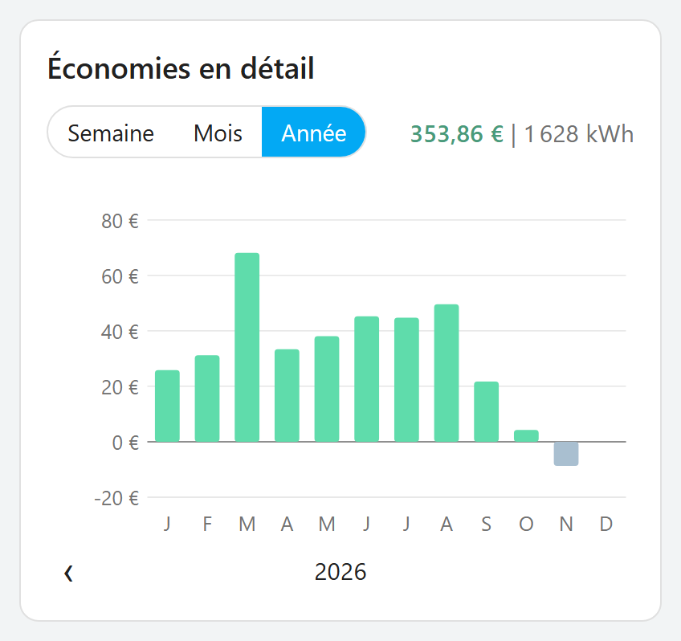
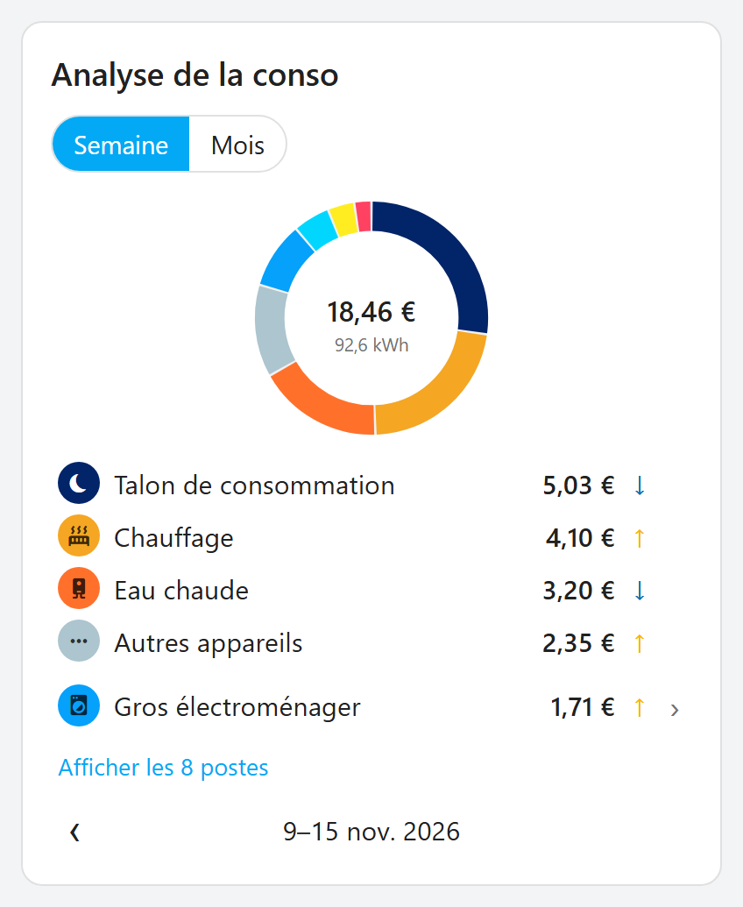
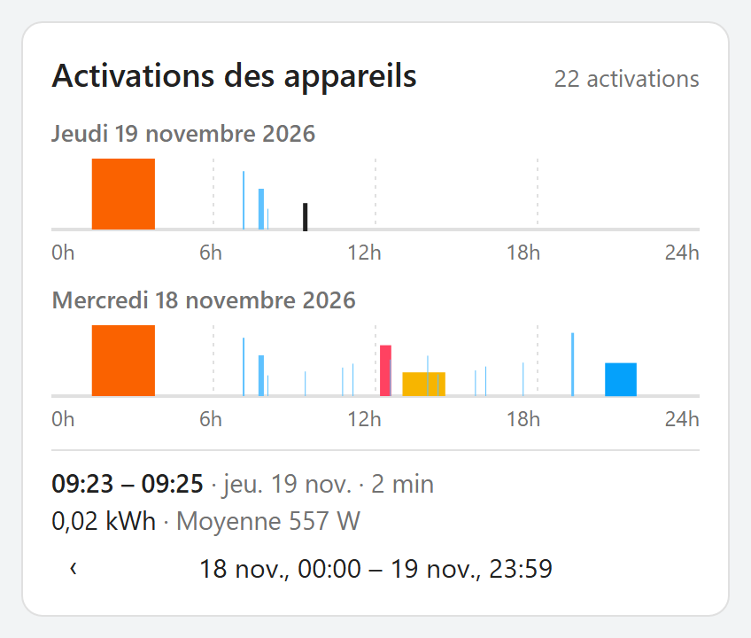
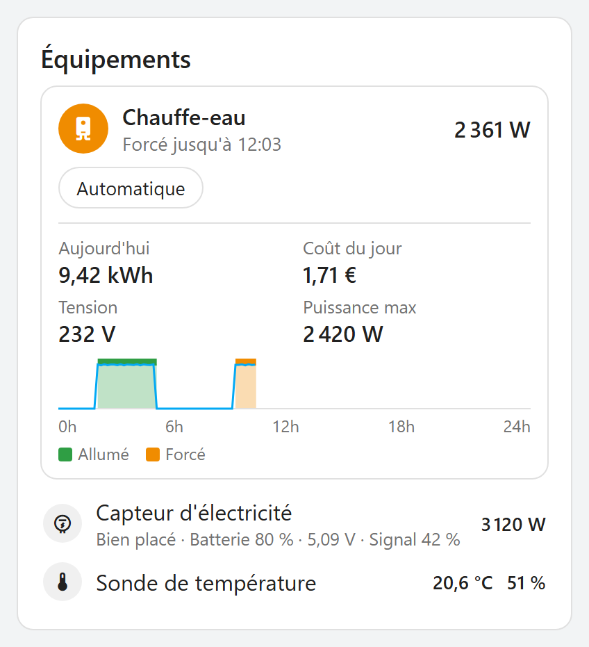
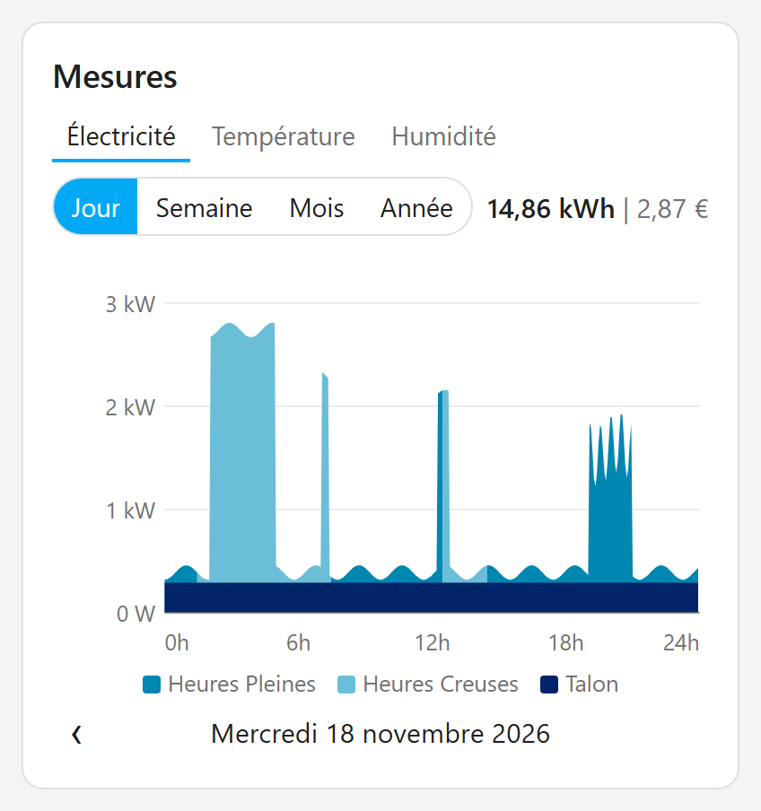

# Les cartes du tableau de bord

[← Retour à l'accueil](../README.md) · [Installation](installation.md) · [L'intégration](integration.md)

Little Monkey fournit huit cartes qui reprennent les écrans de l'application ecojoko<sup>©️</sup>. Elles sont chargées automatiquement par l'intégration : il n'y a ni ressource Lovelace ni dépôt à ajouter au Marketplace, et elles suivent toujours la version de l'intégration.

- [Ajouter une carte](#ajouter-une-carte)
- [Little Monkey (cadran)](#little-monkey-cadran)
- [Contrat](#contrat)
- [Économies](#économies)
- [Économies en détail](#économies-en-détail)
- [Analyse de la conso](#analyse-de-la-conso)
- [Activations des appareils](#activations-des-appareils)
- [Équipements](#équipements)
- [Mesures](#mesures)

## Ajouter une carte

Modifiez un tableau de bord, cliquez sur **Ajouter une carte** et cherchez **Petit Singe** (« Little Monkey » en anglais). Chaque carte a un éditeur visuel qui choisit seul les capteurs de votre appareil Little Monkey ; vous pouvez aussi la configurer en YAML.

| Carte | Option de l'intégration nécessaire |
|---|---|
| Little Monkey (cadran) | aucune ; faces 2 à 4 avec Activité du compte |
| Contrat | Contrat |
| Économies, Économies en détail | Économies |
| Analyse de la conso, Activations des appareils | Analyse de la conso |
| Équipements | Équipements pilotés |
| Mesures | Mesures |

Sans son option, une carte affiche un message qui indique où l'activer : Paramètres › Appareils et services › Little Monkey › **Configurer** ([voir les options](installation.md#3-les-autres-capteurs-et-fonctions)).

Dans les cartes, toucher une valeur ouvre ses détails dans Home Assistant, avec son historique, quand elle a un capteur. Les cartes suivent les thèmes clair et sombre, en français et en anglais. Les captures de ce guide utilisent des données fictives.

## Little Monkey (cadran)

<picture>
  <source media="(prefers-color-scheme: dark)" srcset="images/cards/dial-dark.png">
  
</picture>

Le cadran du boîtier ecojoko.

- **L'arc du haut** montre la puissance en temps réel sur une échelle logarithmique (0, 50, 100, 500, 1K, 5K, 10K, MAX), en zones de plus en plus marquées.
- **Le disque central** affiche la puissance en W, la puissance apparente en VA quand elle est disponible, et la courbe des dernières minutes. Avec les totaux HC/HP ou un contrat Tempo, il prend la couleur de la période en cours et en affiche le nom (« HEURES CREUSES », « HEURES PLEINES · JOUR ROUGE ») ; il passe au vert et titre « INJECTION RÉSEAU » pendant l'injection d'un surplus.
- **L'aiguille du bas** indique vos économies sur 7 jours, de -20 % (économie, côté vert) à +20 % (surconsommation).

Comme sur le boîtier, le disque a plusieurs faces, que l'on fait défiler en glissant le doigt ou avec les points : la puissance temps réel ; les économies sur 7 jours ; le coût et la consommation sur 7 jours avec l'histogramme des jours ; la puissance maximale du mois, de l'année et depuis le début. Les faces 2 à 4 et l'aiguille demandent l'option Activité du compte. La carte revient d'elle-même sur la puissance au bout de 30 secondes.

| Période | Heures creuses | Heures pleines |
|---|---|---|
| HC/HP, Tempo Bleu | bleu foncé | bleu |
| Tempo Blanc | gris clair | blanc |
| Tempo Rouge | rouge foncé | rouge |

```yaml
type: custom:little-monkey-card
entity: sensor.ecojoko_consommation_temps_reel
```

| Option | Description |
|---|---|
| `entity` | Capteur Consommation Temps Réel (obligatoire) |
| `apparent_power_entity` | Puissance apparente ; par défaut celle du même appareil Little Monkey |
| `tariff_entity` | Entité donnant la période en cours ; par défaut la Période Tarifaire en Cours. Accepte aussi une source plus réactive : RTE Tempo, téléinformation du compteur Linky (`HCJB`, `HPJR`…), capteur binaire allumé en heures creuses |
| `tempo_color_entity` | Entité donnant la couleur Tempo du jour, si `tariff_entity` ne la donne pas |
| `savings_entity` | Écart sur 7 jours, pour l'aiguille du bas ; par défaut celui du même appareil |
| `max_power` | Puissance de la graduation MAX, en W (12 000 par défaut) |
| `trend_minutes` | Durée de la courbe du disque, en minutes (3 par défaut, de 1 à 60) |
| `return_seconds` | Délai du retour sur la puissance, en secondes (30 par défaut, 0 pour rester sur la face choisie) |
| `relief` | Relief du cadran (`true` par défaut, `false` pour un cadran plat) |
| `dial_color` | Fond du cadran : `default` (teinte tirée du thème), `none` (transparent), une couleur de la palette de Home Assistant (`light-blue`, `amber`…) ou une couleur libre (`"#1e2832"`) |

## Contrat

<picture>
  <source media="(prefers-color-scheme: dark)" srcset="images/cards/contract-dark.png">
  
</picture>

Votre contrat d'électricité en un coup d'œil.

- Le fournisseur, l'offre, sa date de début et la puissance souscrite.
- Un cadran des 24 heures avec les heures creuses, une aiguille sur l'heure actuelle, la période en cours et le prochain changement (« Heures pleines à 07:30, dans 1 h 45 ») ; aux couleurs du jour avec Tempo. L'heure est celle de la France, comme les heures creuses d'ecojoko, où que soit le navigateur. Pour un contrat sans heures creuses, le cadran n'indique pas de période.
- Les tranches tarifaires avec leur badge HC ou HP et le prix d'un kWh, la tranche en cours en gras, l'abonnement mensuel et, si vous revendez votre surplus solaire, son prix de rachat, celui de vos paramètres de production solaire dans ecojoko. Un prix estimé est précédé de « ≈ » ([voir pourquoi](integration.md#contrat)) ; toucher une tranche ouvre sa consommation du jour.

```yaml
type: custom:little-monkey-contract-card
entity: sensor.ecojoko_contrat
```

| Option | Description |
|---|---|
| `entity` | Capteur Contrat (obligatoire) |
| `title` | Titre affiché au-dessus du contrat |

## Économies

<picture>
  <source media="(prefers-color-scheme: dark)" srcset="images/cards/savings-dark.png">
  
</picture>

Le résumé de l'onglet « Économies » d'ecojoko : trois barres pour les 12 derniers mois, la consommation en cours, la consommation de référence et les économies (« Surconsommation », en orange, quand elles sont négatives).

```yaml
type: custom:little-monkey-savings-summary-card
entity: sensor.ecojoko_economies_sur_12_mois
unit: eur
```

| Option | Description |
|---|---|
| `entity` | Capteur Économies sur 12 Mois (obligatoire) |
| `unit` | `eur` (par défaut) ou `kwh` |
| `consumption_entity`, `reference_entity` | Coûts de la consommation et de référence sur 12 mois ; par défaut ceux du même appareil |
| `title` | Titre de la carte |

## Économies en détail

<picture>
  <source media="(prefers-color-scheme: dark)" srcset="images/cards/detail-dark.png">
  
</picture>

Les économies d'une semaine (jour par jour), d'un mois (semaine par semaine) ou d'une année (mois par mois), en barres vertes pour une économie et gris-bleu pour une surconsommation.

- Les boutons Semaine, Mois et Année changent de période ; le total de la période s'affiche à côté, l'unité choisie en premier.
- Les flèches, ou un glissement du doigt sur les barres, passent à la période précédente ou suivante ; les périodes passées sont lues chez ecojoko. La carte s'arrête à la première période qu'ecojoko connaît : la flèche précédente disparaît.
- Toucher une barre affiche son détail (« Lundi 16 novembre : -0,35 € · -2,57 kWh »).

```yaml
type: custom:little-monkey-savings-detail-card
entity: sensor.ecojoko_economies_de_la_semaine
period: week
unit: eur
```

| Option | Description |
|---|---|
| `entity` | Capteur Économies de la Semaine, du Mois ou de l'Année (obligatoire) ; la carte trouve les deux autres |
| `period` | Période affichée d'abord : `week` (par défaut), `month` ou `year` |
| `unit` | Unité des barres : `eur` (par défaut) ou `kwh` |
| `title` | Titre de la carte |

## Analyse de la conso

<picture>
  <source media="(prefers-color-scheme: dark)" srcset="images/cards/analysis-dark.png">
  
</picture>

La page « Analyse de votre conso » d'ecojoko : la consommation d'une semaine ou d'un mois par poste (talon, éclairage, froid, cuisson, chauffage, eau chaude…).

- Un anneau coloré avec le coût et l'énergie au centre et, à côté, les principaux postes sur une ligne chacun, avec leur part, leur coût et une flèche quand ils sont en hausse ou en baisse.
- Seuls les 5 plus gros postes sont affichés d'abord ; « Afficher les N postes » déplie la liste. La flèche › d'un poste affiche ses sous-postes (lave-vaisselle, lavage et séchage du linge…).
- Toucher un poste affiche son historique semaine par semaine sur l'année.
- ecojoko analyse une période une fois terminée : la carte s'ouvre sur la dernière période analysée, et les flèches remontent dans le temps. ecojoko n'analyse pas les années.

```yaml
type: custom:little-monkey-analysis-card
entity: sensor.ecojoko_consommation_temps_reel
period: week
```

| Option | Description |
|---|---|
| `entity` | Un capteur de l'appareil Little Monkey, qui désigne l'installation (obligatoire) |
| `period` | Période affichée d'abord : `week` (par défaut) ou `month` |
| `max_categories` | Postes affichés avant de déplier la liste : 5 par défaut, 0 pour tous |
| `title` | Titre de la carte |

## Activations des appareils

<picture>
  <source media="(prefers-color-scheme: dark)" srcset="images/cards/activations-dark.png">
  
</picture>

Les démarrages d'appareils détectés par ecojoko sur 48 heures, en une frise de 24 heures par jour : chaque activation est une impulsion à son heure, aussi large qu'elle dure, aussi haute que sa puissance, à la couleur d'ecojoko. Toucher une impulsion affiche ses heures, sa durée, son énergie et sa puissance moyenne ; les flèches passent aux 48 heures précédentes. La carte se met à jour toutes les dix minutes. Avec `mode: list`, elle affiche la liste des dernières activations.

```yaml
type: custom:little-monkey-activations-card
entity: sensor.ecojoko_consommation_temps_reel
mode: timeline
```

| Option | Description |
|---|---|
| `entity` | Un capteur de l'appareil Little Monkey, qui désigne l'installation (obligatoire) |
| `mode` | `timeline` (une frise par jour, par défaut) ou `list` |
| `title` | Titre de la carte |

## Équipements

<picture>
  <source media="(prefers-color-scheme: dark)" srcset="images/cards/equipment-dark.png">
  
</picture>

L'écran « Équipements » d'ecojoko, avec le pilotage du chauffe-eau.

- **Un bloc par équipement piloté** : son mode (« Forcé jusqu'à 21:30 », « Automatique · éteint »), sa puissance et les boutons d'ecojoko. **Forcé** propose 1, 2, 3 ou 4 heures, ou une autre durée en minutes ; **Absence** demande la date et l'heure de retour (minuit par défaut) ; **Automatique**, **Allumer** et **Éteindre** demandent une confirmation.
- **Ouvert**, le bloc montre la consommation et le coût du jour, la tension, la puissance maximale et la frise de la journée : les périodes allumé, forcé et absent, et la courbe de puissance.
- **Avec plusieurs équipements**, chaque bloc tient sur une ligne et un seul est ouvert à la fois.
- **Les autres équipements** (capteur d'électricité, sonde…) sont listés en dessous avec leurs mesures et, sous leur nom, l'état de l'installation, la batterie et la tension des piles, et la force du signal.

La carte ne connaît pas les types d'équipements : ses boutons sont ceux qu'ecojoko propose pour chacun. Elle se met à jour dès que le mode d'un équipement change, par exemple à la fin d'un forçage.

```yaml
type: custom:little-monkey-equipment-card
entity: sensor.ecojoko_consommation_temps_reel
```

| Option | Description |
|---|---|
| `entity` | Un capteur de l'appareil Little Monkey, de préférence Consommation Temps Réel (obligatoire) |
| `equipment` | Un seul équipement piloté, par son nom ou son id ecojoko : une carte par équipement |
| `show_list` | `false` pour ne pas lister les équipements non pilotés |
| `title` | Titre de la carte |

## Mesures

<picture>
  <source media="(prefers-color-scheme: dark)" srcset="images/cards/measures-dark.png">
  
</picture>

La page « Mesures » d'ecojoko, avec trois onglets.

- **Électricité, Jour** : la courbe de puissance colorée selon la tranche tarifaire de chaque instant (heures pleines, heures creuses, couleurs Tempo…), le talon de consommation en bleu foncé dessous et la production injectée sous l'axe. Toucher la courbe donne la puissance à cette heure.
- **Électricité, Semaine, Mois, Année** : les jours ou les mois en barres empilées par tranche, en kWh ou en euros, avec la production injectée sous l'axe. La légende donne le total de chaque tranche ; toucher une barre affiche son détail.
- **Totaux** : en haut à droite, la consommation et son coût, avec le surplus injecté entre les deux. Si vous revendez votre surplus, deux lignes : « Achat » (consommation et coût) et « Revente » (surplus et montant de la revente) ; le détail d'une barre donne aussi le montant de sa revente.
- **Température, Humidité** : les courbes intérieure et extérieure, avec la moyenne intérieure. Elles viennent des statistiques des capteurs de Home Assistant quand ceux-ci couvrent toute la période, sinon d'ecojoko, qui a tout l'historique de la sonde.
- **Navigation** : les flèches, ou un glissement du doigt, passent à la période précédente ou suivante. Le mois est le mois calendaire, pour les trois onglets. La carte s'arrête à la première période qu'ecojoko connaît : la flèche précédente disparaît.

```yaml
type: custom:little-monkey-measures-card
entity: sensor.ecojoko_consommation_temps_reel
measure: electricity
period: day
unit: kwh
```

| Option | Description |
|---|---|
| `entity` | Un capteur de l'appareil Little Monkey, qui désigne l'installation (obligatoire) |
| `measure` | Onglet affiché d'abord : `electricity` (par défaut), `temperature` ou `humidity` |
| `period` | Période affichée d'abord : `day` (par défaut), `week`, `month` ou `year` |
| `unit` | Unité des barres et du total : `kwh` (par défaut) ou `eur` |
| `title` | Titre de la carte |
