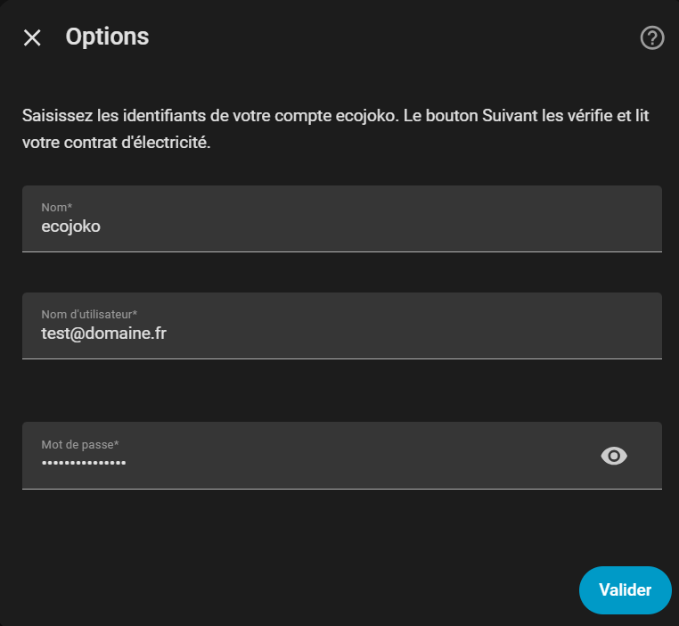
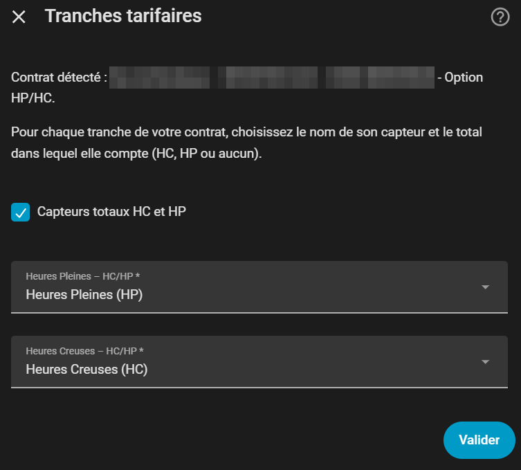
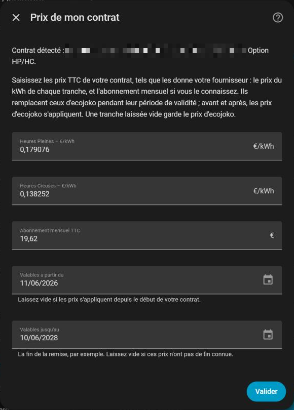
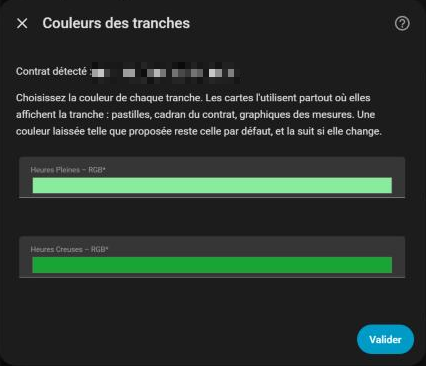
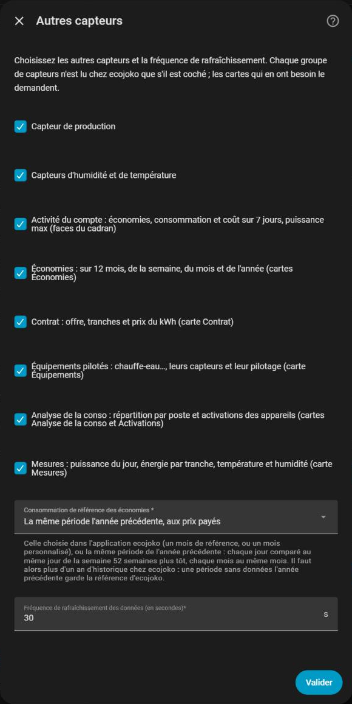

# Installation et configuration

[← Retour à l'accueil](../README.md) · [L'intégration](integration.md) · [Les cartes](cartes.md)

- [Prérequis](#prérequis)
- [Installer avec le Marketplace](#installer-avec-le-marketplace)
- [Ajouter l'intégration](#ajouter-lintégration)
- [Les options](#les-options)
- [Mettre à jour depuis la 1.2.8](#mettre-à-jour-depuis-la-128)
- [Dépannage](#dépannage)
- [Désinstaller](#désinstaller)

## Prérequis

- Un assistant d'énergie ecojoko©️ installé et relié à votre compteur.
- Les identifiants de votre compte sur [service.ecojoko.com](https://service.ecojoko.com/).
- Home Assistant 2024.7 ou plus récent, et le Marketplace (anciennement [HACS](https://hacs.xyz/)).

## Installer avec le Marketplace

1. Ajoutez le dépôt de l'intégration au Marketplace en cliquant sur ce bouton, puis sur **Ajouter** :

   

2. Sur la page de Little Monkey dans le Marketplace, cliquez sur **Télécharger**.
   Pour tester une version bêta, cherchez Little Monkey dans le Marketplace, ouvrez le menu ⋮ de sa ligne › **Installer une autre version**, choisissez dans la liste **Version** celle qui est marquée « Pré-version », quand il y en a une, puis cliquez sur **Mettre à jour**. Faites une sauvegarde avant.
3. Redémarrez Home Assistant (Paramètres › Système › menu ⏻ › **Redémarrer Home Assistant**).

Les cartes du tableau de bord sont fournies par l'intégration elle-même : il n'y a ni ressource Lovelace ni dépôt supplémentaire à ajouter au Marketplace.

## Ajouter l'intégration

Allez dans **Paramètres › Appareils et services**, cliquez sur **Ajouter une intégration** et cherchez **Little Monkey**. La configuration tient sur trois écrans.

### 1. Votre compte

| Champ | Description |
|---|---|
| Nom | Nom de l'appareil, qui préfixe le nom de tous les capteurs (« Ecojoko Consommation Temps Réel »…) |
| Nom d'utilisateur, Mot de passe | Vos identifiants ecojoko |

**Suivant** vérifie vos identifiants et lit le contrat d'électricité renseigné dans ecojoko. Un même compte ne peut être ajouté qu'une fois ; plusieurs comptes ecojoko peuvent coexister, chacun avec son entrée.

### 2. Les tranches tarifaires

L'écran affiche le contrat détecté et ses tranches (Heures Pleines et Creuses, Tempo Bleu, Blanc et Rouge, Semaine, Week-end, Jour Spécial…).

| Champ | Description |
|---|---|
| Capteurs totaux HC et HP | Crée « Consommation HC Réseau » et « Consommation HP Réseau », qui additionnent les tranches de chaque catégorie |
| Saisir les prix de mon contrat | Ouvre un écran pour saisir vos propres prix (voir ci-dessous) |
| Choisir les couleurs des tranches | Ouvre un écran pour choisir la couleur de chaque tranche dans les cartes (voir ci-dessous) |
| Pour chaque tranche | Le nom de son capteur (prérempli) et le total dans lequel elle compte : Heures Creuses, Heures Pleines ou aucun |
| Tranches à supprimer | Les tranches à retirer avec leur capteur, par exemple celles d'un ancien contrat qu'ecojoko donne encore |

Une tranche qu'ecojoko renomme garde son capteur et le nom que vous lui avez donné. Après un changement de contrat, ouvrez les options : elles reprennent cet écran avec les tranches du nouveau contrat, et une réparation le signale dans Home Assistant quand une tranche n'a pas de capteur. Les tranches de l'ancien contrat disparaissent d'elles-mêmes quand ecojoko ne les donne plus dans ses statistiques des dernières semaines ; pour les retirer tout de suite, cochez-les dans « Tranches à supprimer ». Elles ne sont alors plus proposées ni signalées tant qu'ecojoko les donne encore, et restent cochées dans cette liste : décochez-en une pour la remettre.

#### Les prix de votre contrat

ecojoko ne connaît pas toujours les prix de votre contrat : une remise pour les nouveaux clients, par exemple, ou une offre absente de son catalogue. Vérifiez d'abord, dans l'application ecojoko (Paramètres › Tarifs d'électricité), que l'offre déclarée est bien la vôtre : la corriger là corrige les prix partout. Sinon, cochez « Saisir les prix de mon contrat » : un écran de plus vous demande les prix TTC donnés par votre fournisseur.

| Champ | Description |
|---|---|
| Pour chaque tranche | Le prix TTC d'un kWh ; une tranche laissée vide garde le prix d'ecojoko |
| Abonnement mensuel TTC | Facultatif |
| Valables à partir du, jusqu'au | La période de ces prix, par exemple celle d'une remise ; avant et après, les prix d'ecojoko s'appliquent. Laissez vide pour une période sans début ou sans fin |

La carte Contrat affiche alors ces prix, avec la mention « Prix saisis dans les options de l'intégration ». Les coûts sont recalculés à ces prix pendant leur période : ceux de la carte Mesures et du service `get_measures` (jours, mois, années, et chaque tranche), le coût sur 7 jours de l'activité, et le coût du jour d'un équipement piloté. Seul le prix du kWh change, la part d'abonnement comptée par ecojoko reste : le prix d'ecojoko retiré est celui de chaque mois, estimé d'après les jours complets de ce mois (avec le mois d'avant pendant ses premiers jours), si bien qu'un changement de ses prix s'applique au bon mois ; un abonnement saisi ajoute son écart jour par jour. Un mois n'est recalculé que si les prix s'appliquent à tout le mois.

Les économies suivent : le coût de votre consommation est recalculé de la même façon, et le coût de la consommation de référence au prix moyen du kWh que vous avez payé sur la même période (ecojoko valorise lui aussi sa référence à un prix unique, sans tranches) ; l'économie en euros est leur différence. Cela vaut pour les capteurs d'économies (12 mois, semaine, mois, année), la carte « Détail des économies » et le service `get_savings`. L'analyse de la conso, qu'ecojoko ne détaille pas par tranche, change dans la même proportion que le coût de la période. Décochez la case pour revenir aux prix d'ecojoko.

#### Les couleurs des tranches

Les cartes affichent chaque tranche dans sa couleur : les pastilles et le cadran de la carte Contrat, les courbes et les barres de la carte Mesures, le disque du cadran. Par défaut :

- Heures Pleines et Heures Creuses : bleu clair et bleu foncé ;
- Tempo : bleu, blanc (gris clair et gris) et rouge, clair pour les heures pleines et foncé pour les heures creuses ;
- une autre tranche : la couleur que lui donne ecojoko, sinon celle de sa catégorie (HC ou HP), sinon une couleur distincte pour chaque tranche comptée ni en HC ni en HP.

Pour choisir les vôtres, cochez « Choisir les couleurs des tranches » : un écran de plus, après celui des prix s'il est demandé, propose un sélecteur de couleur par tranche, prérempli avec sa couleur actuelle.

Une couleur laissée telle que proposée reste celle par défaut. Décochez la case pour revenir aux couleurs par défaut de toutes les tranches. Le texte posé sur une couleur (le disque du cadran) est foncé ou blanc selon sa clarté.

### 3. Les autres capteurs et fonctions

| Case | Par défaut | Effet |
|---|---|---|
| Capteur de production | décochée | Surplus de production injecté, pour un assistant ecojoko ancienne génération et des panneaux solaires |
| Capteurs d'humidité et de température | décochée | Température et humidité intérieures et extérieures de la sonde |
| Activité du compte | décochée | Économies, consommation et coût sur 7 jours, économies cumulées, puissances maximales ; faces 2 à 4 de la carte Little Monkey |
| Économies | décochée | Coûts et économies sur 12 mois, de la semaine, du mois et de l'année ; cartes Économies |
| Consommation de référence des économies | celle d'ecojoko | Celle choisie dans l'application ecojoko, ou la même période de l'année précédente, à prix égal ou aux prix payés ([voir plus bas](integration.md#la-référence-des-économies)) |
| Contrat | décochée | L'offre, ses tranches et le prix d'un kWh ; carte Contrat |
| Équipements pilotés | décochée | Le chauffe-eau (ou tout équipement piloté par ecojoko), ses capteurs et son pilotage ; carte Équipements |
| Analyse de la conso | décochée | La répartition par poste et les activations des appareils ; cartes Analyse de la conso et Activations |
| Mesures | décochée | La puissance du jour, l'énergie par tranche, la température et l'humidité ; carte Mesures |
| Fréquence de rafraîchissement | 30 s | Intervalle de lecture du temps réel, de 5 à 60 secondes. **Il est recommandé de rester à 30 secondes au minimum** : les API actuelles d'ecojoko supportent mal un intervalle plus court. ecojoko ne rafraîchit le temps réel de l'intégration que toutes les 30 secondes : un intervalle plus court relit la même valeur. À la mise à jour depuis la 2.0.0b1 ou la 1.2.8, un intervalle inférieur à 30 s est porté à 30 s ; depuis la 2.0.0b2, un intervalle inférieur à 5 s est porté à 5 s. L'énergie du jour, la température et l'humidité sont lues à leur propre rythme, quel que soit cet intervalle |

Les six dernières cases, apparues avec la version 2.0.0, sont décochées par défaut : leurs capteurs ne sont créés, et leurs données lues chez ecojoko, que si elles sont cochées. Voir [les capteurs de chaque option](integration.md#les-capteurs).

> [!NOTE]
> Les noms des capteurs suivent la langue de votre instance Home Assistant : français, anglais ou portugais, anglais pour les autres langues.

## Les options

Le bouton **Configurer** de l'intégration reprend les trois écrans. Les nouveaux réglages ne sont enregistrés qu'après validation des identifiants par ecojoko, et l'intégration n'est rechargée qu'une fois.

- **Cocher une case** crée ses capteurs ; ceux qui existaient avant retrouvent leur historique.
- **Décocher une des six cases de la version 2.0.0** supprime ses capteurs, et les appareils des équipements pour « Équipements pilotés ». Les cartes qui en ont besoin affichent alors un message qui invite à la réactiver.
- **Décocher une autre case, ou changer de contrat**, laisse les capteurs concernés dans Home Assistant, à l'état « indisponible » : leur historique et leurs statistiques sont conservés. Les cartes n'en tiennent plus compte ; supprimez-les depuis leur page si vous n'en avez plus besoin.
- **Changer le nom** renomme l'appareil et le nom affiché des capteurs ; leurs identifiants et leur historique sont conservés.
- **Changer le nom d'utilisateur**, après l'avoir changé chez ecojoko, ne touche à aucun capteur : ils sont attachés à l'installation, pas au compte. Le titre de l'intégration suit le nouveau nom d'utilisateur, sauf si vous l'avez renommée. Un compte déjà utilisé par une autre installation Little Monkey est refusé.

## Mettre à jour depuis la 1.2.8

L'installation est convertie automatiquement au premier démarrage :

- les capteurs HC/HP et Tempo gardent leurs identifiants, leur historique et leurs statistiques ; l'option Tempo disparaît, un contrat Tempo n'étant plus qu'un contrat parmi d'autres ;
- pour un autre contrat (Week-end, Jour Spécial…), une réparation propose de créer les capteurs de ses tranches ;
- les nouvelles fonctions de la 2.0.0 sont décochées : ouvrez **Configurer** pour les activer ;
- une fréquence de rafraîchissement inférieure à 30 secondes est portée à 30, le minimum recommandé ;
- pour voir les nouvelles cartes, rechargez la page du navigateur sans son cache (**Ctrl+F5**, ou **Cmd+Maj+R** sur Mac) après le redémarrage ; dans l'application mobile, fermez-la complètement puis rouvrez-la.

> [!WARNING]
> Revenir ensuite à une version antérieure à la 1.2.8 demande de restaurer une sauvegarde ou de reconfigurer l'intégration.

## Dépannage

- **Les capteurs sont indisponibles** : ecojoko ne répond plus depuis plus de deux minutes. Une coupure plus courte conserve les dernières valeurs. L'état de chaque lecture est dans les journaux (Paramètres › Système › Journaux).
- **Les valeurs semblent figées** : ecojoko ne sert des données en direct que pendant dix minutes après la lecture de la liste de ses passerelles ; l'intégration la relit toutes les cinq minutes pour les maintenir vivantes. Un proxy ou un filtrage réseau qui met en cache les réponses d'ecojoko peut figer les données.
- **Une carte ne change pas après une mise à jour** : sur l'application mobile, videz le cache du frontend dans ses paramètres. Dans un navigateur, les cartes sont rechargées d'elles-mêmes.
- **Signaler un problème** : joignez les diagnostics (page de l'intégration › menu ⋮ › **Télécharger les diagnostics**). Vos identifiants, le nom de l'installation et les identifiants de vos équipements en sont retirés. Ouvrez une [issue](https://github.com/jmcruvellier/little_monkey/issues).

## Désinstaller

Supprimez l'entrée de l'intégration (page de l'intégration › menu ⋮ › **Supprimer**), puis Little Monkey dans le Marketplace, et redémarrez Home Assistant.
