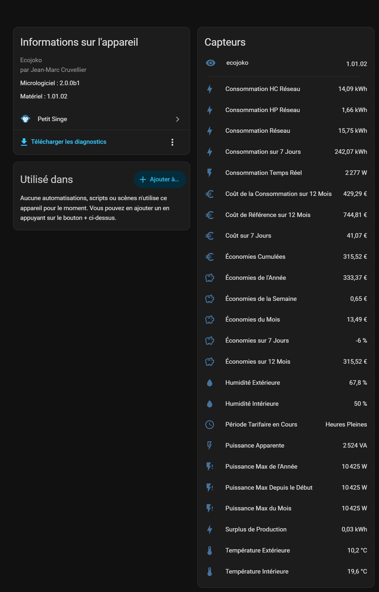
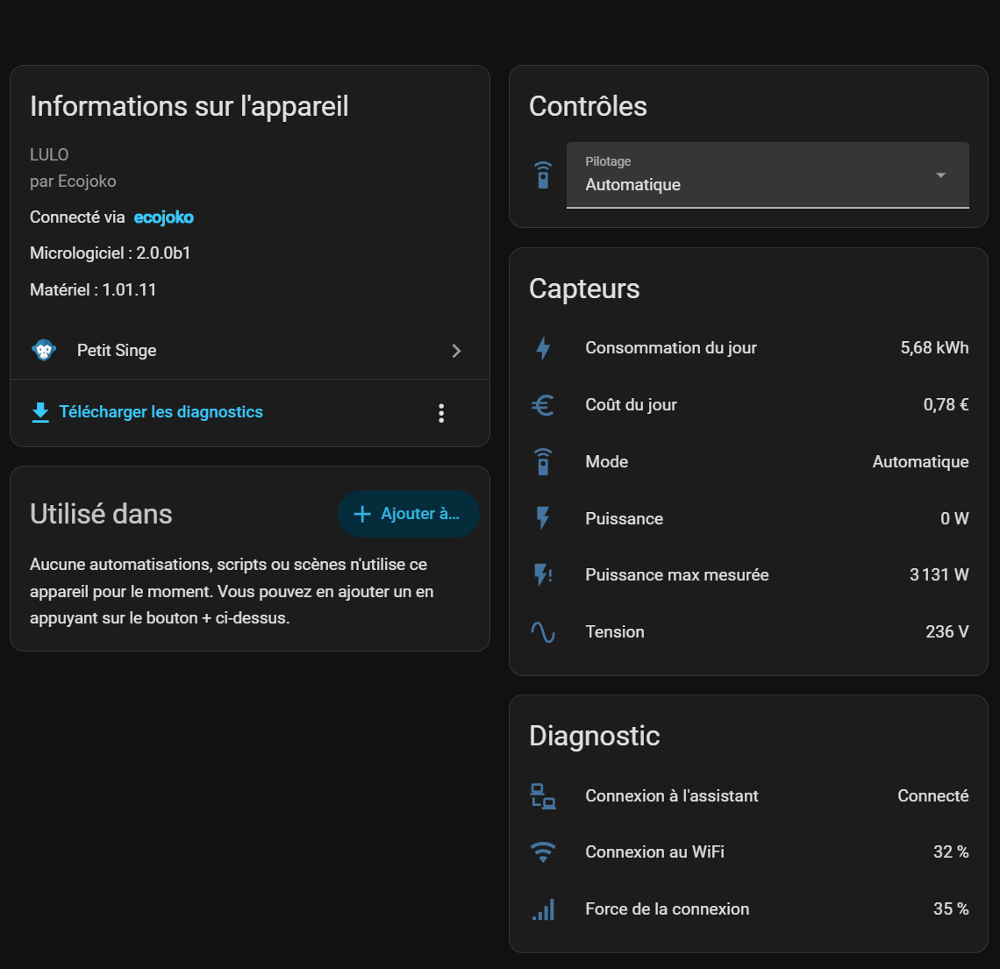
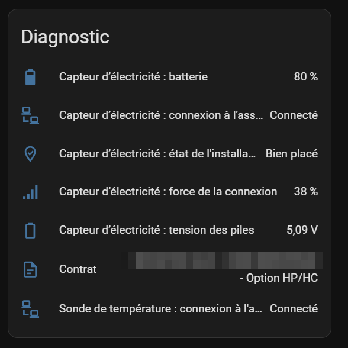

# L'intégration

[← Retour à l'accueil](../README.md) · [Installation](installation.md) · [Les cartes](cartes.md)

Little Monkey lit les données de votre assistant d'énergie ecojoko<sup>©️</sup> sur les serveurs d'ecojoko et les met à disposition de Home Assistant : des capteurs pour l'historique, le tableau de bord Énergie et les automatisations, des services pour lire les données détaillées à la demande, et le pilotage du chauffe-eau.

- [Les appareils](#les-appareils)
- [Les capteurs](#les-capteurs)
- [Le pilotage des équipements](#le-pilotage-des-équipements)
- [Les services](#les-services)
- [Ce qu'il faut savoir sur ecojoko](#ce-quil-faut-savoir-sur-ecojoko)

## Les appareils

| Appareil | Contenu |
|---|---|
| **Ecojoko** (le nom choisi à la configuration) | Tous les capteurs de l'installation. « Micrologiciel » donne la version de Little Monkey, « Matériel » celle de l'assistant ecojoko |
| **Un appareil par équipement piloté** (le chauffe-eau…), avec l'option Équipements pilotés | Ses capteurs, sa liste « Pilotage » et ses diagnostics, « connecté via » l'appareil Ecojoko. « Matériel » donne la version de l'équipement |





## Les capteurs

### Capteurs de base

Toujours créés, ou selon les cases de la 1.2.8.

| Capteur | Unité | Création | Description |
|---|---|---|---|
| Consommation Temps Réel | W | toujours | Puissance consommée, lue à la fréquence de rafraîchissement ; négative en cas d'injection |
| Puissance Apparente | VA | si ecojoko la donne | Lue sur le compteur Linky |
| Consommation Réseau | kWh | toujours | Énergie consommée depuis minuit ; ne diminue jamais au cours d'une journée |
| Consommation d'une tranche tarifaire | kWh | une par tranche du contrat | Énergie de la tranche depuis minuit (Heures Creuses, HC Bleu, HP Semaine…), nommée à la configuration |
| Consommation HC Réseau, HP Réseau | kWh | case des totaux HC et HP | Somme des tranches de chaque catégorie |
| Période Tarifaire en Cours | — | totaux HC/HP ou contrat Tempo | Heures creuses ou pleines, et couleur du jour en Tempo ; la tranche en cours en attribut (`tariff_band`). Déduite du compteur qui augmente : connue avec quelques minutes de retard au changement de période |
| Surplus de Production | kWh | case Production | Énergie injectée depuis minuit |
| Température Intérieure, Extérieure | °C | case Température et humidité | Mesures de la sonde ecojoko ; l'extérieure vient de la météo de votre commune |
| Humidité Intérieure, Extérieure | % | case Température et humidité | Idem |

### Activité du compte

| Capteur | Unité | Description |
|---|---|---|
| Écart sur 7 Jours | % | Écart de la consommation des 7 derniers jours avec votre consommation de référence, négatif pour une économie ; inconnu tant qu'ecojoko n'a pas de semaine de référence. Consommation de référence en attribut |
| Consommation sur 7 Jours | kWh | Celle de chaque jour en attribut, du plus ancien au plus récent |
| Coût sur 7 Jours | € | Selon le tarif renseigné dans ecojoko |
| Économies Cumulées | € | Depuis le début, négatives en cas de surconsommation |
| Puissance Max du Mois, de l'Année, Depuis le Début | W | |

Lus toutes les dix minutes, à part des autres capteurs : ecojoko calcule ces valeurs lentement. Une panne de cette lecture ne touche jamais le temps réel, et les dernières valeurs sont gardées une heure.

### Économies

| Capteur | Unité | Description |
|---|---|---|
| Coût de la Consommation sur 12 Mois | € | « Conso en cours » du résumé des économies d'ecojoko ; consommation en kWh en attribut |
| Coût de Référence sur 12 Mois | € | Consommation de référence en kWh en attribut |
| Économies sur 12 Mois | € | Différence des deux, négative en cas de surconsommation ; économies en kWh et niveau (1 à 5) en attribut |
| Économies de la Semaine, du Mois, de l'Année | € | Période en cours ; en attribut, les économies en kWh, les coûts et consommations réels et de référence, et le détail jour par jour, semaine par semaine ou mois par mois (`bars`, non historisé) |

Lus toutes les demi-heures, comme l'activité.

### Contrat

| Capteur | Description |
|---|---|
| Contrat (diagnostic) | Nom de l'offre ; en attribut, le fournisseur, le type d'offre, la puissance souscrite (kVA), l'abonnement mensuel, la date de début, les plages d'heures creuses et les tranches configurées, chacune avec le prix d'un kWh (`price`) et son origine (`price_exact`) |

Le prix d'un kWh est celui d'ecojoko quand il le connaît : avec un chauffe-eau piloté, et pas pour toutes les offres. Sinon il est estimé d'après les coûts quotidiens que calcule ecojoko sur deux semaines, part de l'abonnement écartée, au dixième de centime près.

### Équipements pilotés

Pour chaque équipement piloté par ecojoko (chauffe-eau, prise…), sur son appareil :

| Entité | Unité | Description |
|---|---|---|
| Pilotage (liste) | — | Voir [le pilotage](#le-pilotage-des-équipements) |
| Mode | — | Automatique, Forcé ou Absence (Allumé ou Éteint sans mode forcé) ; en attribut, l'état du contacteur tel qu'ecojoko l'écrit, depuis et jusqu'à quand, et l'origine du changement (commande, programmation, fin de durée) |
| Puissance | W | |
| Consommation du Jour, Coût du Jour | kWh, € | Si l'équipement mesure sa consommation |
| Tension, Puissance Max Mesurée | V, W | Si ecojoko les donne |
| Connexion à l'Assistant, Force de la Connexion, Connexion au WiFi, Batterie | —, % | Diagnostics, quand ecojoko les donne. La batterie est affichée comme dans l'application ecojoko, par paliers de 20 % |
| Tension des Piles, État de l'Installation | V, — | Diagnostics des équipements à piles : la tension des piles, et l'emplacement du capteur d'électricité tel qu'ecojoko le juge (« Bien placé ») |

Les équipements non pilotés (capteur d'électricité, sonde…) n'ont pas d'appareil : leurs diagnostics sont sur l'appareil Ecojoko, nommés d'après eux (« Capteur d'électricité : force de la connexion »).



L'état et les mesures d'un équipement piloté sont lus toutes les deux minutes, juste après une commande, et dix secondes après la fin prévue d'un forçage ou d'une absence. L'intégration ne connaît pas les types d'équipements à l'avance : elle lit les commandes qu'ecojoko reconnaît à chacun, si bien qu'un équipement d'un type inconnu est pris en charge dès qu'il accepte les commandes de pilotage. Un équipement ajouté dans ecojoko apparaît après un rechargement de l'intégration ; l'appareil d'un équipement retiré est supprimé au démarrage suivant.

### Analyse de la conso et Mesures

Ces deux options n'ont pas de capteur : elles autorisent les services qui lisent leurs données à la demande, pour les cartes et les automatisations.

## Le pilotage des équipements

La liste **Pilotage** reprend les boutons de l'application ecojoko :

| Choix | Effet |
|---|---|
| Automatique | L'équipement suit de nouveau sa programmation dans ecojoko |
| Forcé | Allumé pendant une heure, puis retour en automatique |
| Absence | Éteint jusqu'à minuit, puis retour en automatique |
| Allumé, Éteint | Pour un équipement sans mode forcé |

Le service `little_monkey.set_equipment_mode` choisit la durée :

| Champ | Obligatoire | Description |
|---|---|---|
| `device_id` | oui | L'appareil de l'équipement |
| `mode` | oui | `auto`, `forced`, `absence`, ou `on` et `off` sans mode forcé |
| `duration` | non | Durée du forçage (une heure par défaut, 24 heures au plus) ou de l'absence, en minutes |
| `until` | non | Fin de l'absence (date et heure), à la place de la durée |

```yaml
# Forcer le chauffe-eau 90 minutes quand la production solaire dépasse 2 kW
automation:
  - alias: Chauffe-eau sur le surplus solaire
    trigger:
      - platform: numeric_state
        entity_id: sensor.ecojoko_consommation_temps_reel
        below: -2000
        for: "00:05:00"
    action:
      - action: little_monkey.set_equipment_mode
        data:
          device_id: 0123456789abcdef  # l'appareil du chauffe-eau
          mode: forced
          duration: 90
```

ecojoko accepte des durées que son application ne propose pas (un forçage de 30 minutes, une absence jusqu'à une heure précise). Si ecojoko ne répond pas, le service renvoie une erreur, mais la commande a pu être appliquée : l'état relu juste après le dit.

## Les services

Les services renvoient une réponse : appelez-les depuis un script ou une automatisation avec `response_variable`, ou depuis Outils de développement › Actions. Les exemples de ce guide utilisent `action:` ; avec Home Assistant 2024.7, écrivez `service:` à la place. `config_entry_id` est facultatif s'il n'y a qu'une installation Little Monkey.

| Service | Option requise | Réponse |
|---|---|---|
| `little_monkey.get_savings` | Économies | Économies d'une semaine, d'un mois ou d'une année (`period`, `date`) : `savings`, `savings_kwh`, coûts et consommations, détail `bars` |
| `little_monkey.get_consumption_analysis` | Analyse de la conso | Répartition d'une semaine ou d'un mois par poste (`period` : `week` ou `month`, `date`) : `categories` avec `name`, `cost`, `consumption`, `percentage`, `trend` et sous-postes. Sans date, la dernière période analysée ; une période pas encore analysée renvoie `available: false` et le message d'ecojoko |
| `little_monkey.get_category_history` | Analyse de la conso | Consommation d'un poste (`category`) semaine par semaine sur une année |
| `little_monkey.get_activations` | Analyse de la conso | Démarrages d'appareils sur 48 heures (`page` 0 pour les dernières, 1 pour les précédentes…) : heures, puissance moyenne, énergie, forme |
| `little_monkey.get_measures` | Mesures | Mesures d'une période (`measure` : `electricity`, `temperature`, `humidity` ; `period` : `day`, `week`, `month`, `year` ; `date`). Électricité : puissance du jour avec sa tranche (`points`), ou énergie et coût des jours ou des mois par tranche (`bars`), production, couleurs des tranches. Température, humidité : intérieur et extérieur (`points`) |
| `little_monkey.get_equipments` | Équipements pilotés | Équipements de l'installation, leur état, leurs diagnostics, leurs entités et les mesures du jour des équipements pilotés ; immédiat, sans interroger ecojoko |
| `little_monkey.set_equipment_mode` | Équipements pilotés | Pilote un équipement ([voir plus haut](#le-pilotage-des-équipements)) |

Sans son option, un service de lecture répond `enabled: false` sans rien lire chez ecojoko. Pour le mois, `get_measures` donne le mois calendaire qui contient la date. Pour une date antérieure aux premières mesures, ecojoko répond avec sa première période : `start` indique la période réellement renvoyée, et `previous` est vide quand il n'y a rien avant. La semaine en cours est demandée à un autre jour de la même semaine : à la date du jour, que l'intégration interroge en continu, ecojoko répond sans la période ni ses totaux. S'il arrive malgré tout qu'ecojoko réponde sans les dates de la période : `start`, `previous` et `next` sont alors absents, et les totaux de la semaine, du mois ou de l'année sont la somme de ses barres.

```yaml
# Économies du mois dernier dans une notification
- action: little_monkey.get_savings
  data:
    period: month
    date: "{{ (now().replace(day=1) - timedelta(days=1)).date() }}"
  response_variable: economies
- action: notify.mobile_app_telephone
  data:
    message: "Économies du mois dernier : {{ economies.savings }} €"
```

## Ce qu'il faut savoir sur ecojoko

> [!IMPORTANT]
> Little Monkey est une intégration **non officielle**. Elle dépend des API d'ecojoko<sup>©️</sup>, qui ne sont pas documentées et peuvent changer ou être indisponibles.

- **Temps réel** : lu à la fréquence choisie (3 à 60 secondes). ecojoko ne sert des données en direct que pendant dix minutes après la lecture de la liste de ses passerelles ; l'intégration la relit toutes les cinq minutes.
- **Énergie du jour** : les compteurs ne diminuent jamais au cours d'une journée, même si ecojoko renvoie un instant une valeur plus basse ; ils repartent de zéro à minuit. Quand ecojoko reclasse après coup de l'énergie d'une tranche dans une autre (des heures creuses vers les heures pleines, par exemple), elle n'est comptée qu'une fois : la somme des totaux HC et HP, comme celle des tranches, ne dépasse jamais la consommation réseau du jour.
- **Coupures** : une coupure de moins de deux minutes conserve les dernières valeurs ; au-delà, les capteurs passent à « indisponible ». Les données lues à part (activité, économies, équipements) gardent leurs dernières valeurs une heure.
- **Liste des équipements** : ecojoko ne la met à jour que toutes les cinq minutes ; l'état d'un équipement piloté est lu directement, plus souvent.
- **Diagnostics** : téléchargeables depuis la page de l'intégration, sans vos identifiants ni le nom de l'installation.
